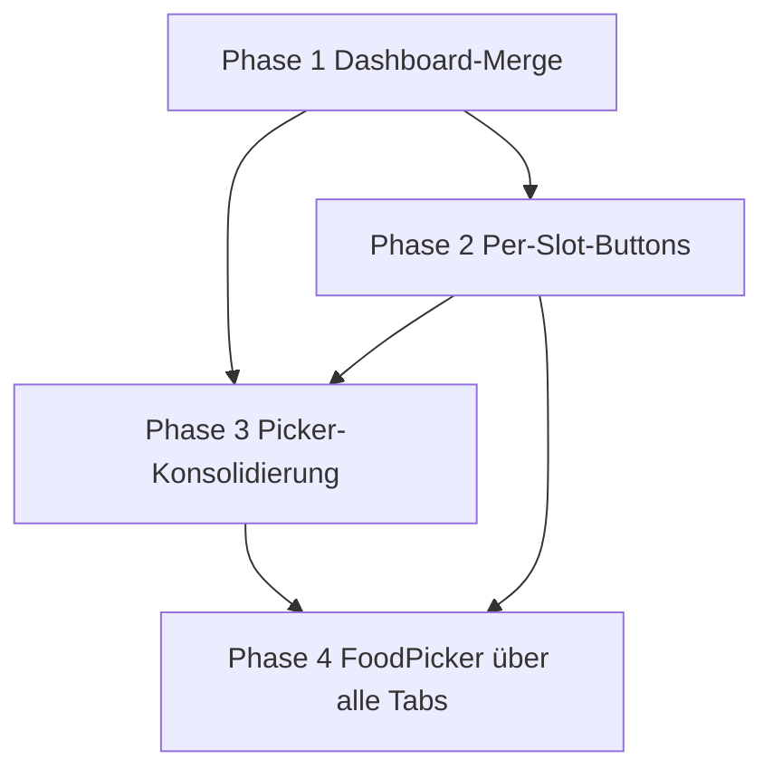

# Refinement Plan — Dashboard/Diary-Merge & Diary-UX-Verbesserungen

## Overview

Dieser Plan beschreibt die schrittweise Umbau der App-Startansicht: Der
Dashboard-Tab wird entfernt, sein Inhalt (Kalorienring + Makro-Balken) wird
als kollabierender Header in den Tagebuch-Screen integriert (Foodvisor-Referenz).
Darauf aufbauend werden die Mahlzeiten-Slots um Per-Slot-"+"-Buttons ergänzt
und die duplizierten Picker-/Barcode-Implementierungen konsolidiert.

### Workflow pro Phase

Jede Phase folgt dem AGENTS.md-Workflow:

1. **Planning** — Analyse & Design
2. **Implementation** — Code schreiben
3. **Unit Tests** — Tests schreiben
4. **Integration Tests** — End-to-End testen
5. **Self Review** — Code-Qualität prüfen
6. **Architecture Explanation** — Entscheidungen dokumentieren
7. **Open Questions / Human in the Loop** — Unklarheiten klären
8. **Refinement** — Plan verfeinern
9. **Acceptance Check** — Prüfen ob alle Kriterien erfüllt
10. **Commit** — Nur nach explizitem Befehl vom User

---

### Design-Entscheidungen (vorab geklärt)

1. **Dashboard-Tab entfällt** — Es gibt keine eigene Dashboard-Kachel mehr.
   `startDestination` des `NavHost` wird `ROUTE_DIARY_DAY`. Verbleibende
   Bottom-Nav-Tabs: Tagebuch, Lebensmittel, Rezepte.

2. **Goals wandern ins Diary-Module** — `GoalsScreen`/`GoalsViewModel`/
   `GoalsAction`/`GoalsEvent`/`GoalsState` + `goalsGraph` ziehen nach
   `:feature:diary:presentation` um. Das Modul `:feature:dashboard:presentation`
   wird vollständig gelöscht (inkl. `settings.gradle.kts`, `app/build.gradle.kts`-
   Referenzen und `DashboardPresentationModule`).

3. **Datumszeile verlässt die TopAppBar** — Datum + Prev/Next + Heute werden
   eine schlanke Row direkt unter dem Collapsing-Header im Content. Die
   TopAppBar zeigt nur noch Titel + Aktionen (Ziele, Gestern kopieren, Verlauf).

4. **QuickAdd als Aktion im FoodPickerSheet** — Die Schnelleingabe erscheint als
   Aktion im Picker-Sheet, das über den Slot-"+"-Button geöffnet wird. Der Slot
   ist dadurch automatisch vorbesetzt; die bestehende `quick_add`-Route bleibt.

5. **Slot-Selector bei fixem Slot ausblenden** — Wird der Picker über einen
   Slot-"+"-Button geöffnet, ist der Slot fix: `AddToDiarySheet` blendet den
   Radio-Selector aus und übernimmt den Slot direkt.

6. **Slot fließt über UI-State, nicht über Koin-Parameter** — Der
   `FoodPickerViewModel` ist ein Koin-`viewModel`, das pro Backstack-Entry
   wiederverwendet wird; Parameter gelten nur beim ersten Erstellen. Der
   Slot wird daher als Composable-Parameter an `FoodPickerSheet` gereicht
   und über eine Action in ein `slot`-Feld von `FoodPickerState` geschrieben.

7. **FoodPickerSheet wird kanonische Implementierung** — Die gemeinsame Logik
   wird als `FoodPickerContent` extrahiert. `FoodPickerSheet` (ModalBottomSheet-
   Wrapper) und ein schlanker `FoodSearchScreen`-Wrapper (TopAppBar, Vollbild)
   nutzen dieselbe Logik. Der Food-Tab und der Diary-"+"-Button teilen die
   zugrundeliegende Logik und unterscheiden sich nur im Kontext.

8. **Neuer Kontext `FoodPickerTarget.BROWSE`** — Für den Food-Tab: Tap auf ein
   Item navigiert zur Detailseite (wie bisher `FoodSearchViewModel` bei
   `addToDiaryDate == null`). `DIARY` + fixer Slot → `AddToDiarySheet` ohne
   Slot-Selector; `RECIPE_INGREDIENT` unverändert.

9. **`BarcodeScanScreen` wird entfernt** — Er hat kein Zusatz-Feature
   (kein Taschenlampen-Toggle, keine manuelle Eingabe) gegenüber dem
   `BarcodeTab`. Die Navigation zu `ROUTE_SCAN` wird durch Öffnen des Pickers
   mit vorausgewähltem Barcode-Tab ersetzt.

10. **Collapsing-Header auch per Tap kollabierbar** — Der Header zeigt auch im
    expanded State einen Chevron; bei kurzer, nicht scrollbarer Liste greift
    das Scroll-basierte Kollabieren sonst nie.

---

## 🔲 Phase 1 — Dashboard-Tab entfernen, CollapsingSummaryHeader in DiaryDay integrieren

### Ziel

Der Dashboard-Screen entfällt. Sein Inhalt (CalorieRing + 4 MacroProgressBars)
wird als `CollapsingSummaryHeader` oben im Tagebuch-Screen integriert und
kollabiert beim Scrollen zu einer schmalen Balkenleiste. Die Goals-Screens
wandern ins Diary-Module; das Dashboard-Module wird gelöscht.

### Änderungen

**1.1 Neue Komponente `CollapsingSummaryHeader`**

- Neue Composable mit zwei visuellen Zuständen:
  - **Expanded:** `CalorieRing` (Restkalorien, verbraucht/gesamtziel) +
    4 horizontale `MacroProgressBar`s (Protein/Fett/Kohlenhydrate/Ballaststoffe)
  - **Collapsed:** schmale Leiste, nur 4 dünne Fortschrittsbalken mit Label,
    kein Ring, plus Chevron zum manuellen Wieder-Ausklappen
- Header liegt **außerhalb** der `LazyColumn` in einer `Column` darüber.
  `LazyListState.firstVisibleItemIndex` + `firstVisibleItemOffset` →
  `collapseFraction: Float` via `derivedStateOf` (0f = expanded, 1f = collapsed).
- `collapseFraction` steuert Höhe/Sichtbarkeit des Rings
  (`graphicsLayer { alpha; scaleX; scaleY }` + Höhenreduktion ohne Leerraum)
  und den Übergang der Balken-Darstellung.
- Manuelles Aus-/Einklappen über Chevron:
  `coroutineScope.launch { lazyListState.animateScrollToItem(0) }` bzw.
  Kollabieren per Tap auf den Header.
- Kein ViewModel-State nötig; Zustand wird NICHT persistiert (startet bei jedem
  Öffnen expanded).

**1.2 `DiaryDayViewModel` mergen**

- `DashboardViewModel`-Logik übernehmen: `goalRepository.observeGoal()` wird
  mit `diaryRepository.observeByDate()` kombiniert (Muster aus
  `DashboardViewModel.kt` `flatMapLatest` + `combine`).
- `DashboardViewModel` löschen, wenn keine weitere Verwendung.
- `DashboardUi`/`buildDashboardUi`/`formatMacro` wandern aus
  `feature/dashboard/.../model/DashboardUi.kt` nach
  `feature/diary/.../model/` (in `DiaryEntryUi`-Nähe).
- **Eine** Summary-Berechnung statt zwei: `buildDashboardUi`-Äquivalent
  (Tagesnährwerte + Ziel-Vergleich) ersetzt die separate `dayTotal`-Ableitung
  über `sumNutrition()`. `DiaryDayState` bekommt `summary: DiarySummaryUi?`;
  die 4 Slot-Listen bleiben unverändert.

**1.3 Navigation & Layout**

- `app/.../MainActivity.kt`:
  - `BottomNavItem(Dashboard, ...)` aus `AppBottomBar` entfernen
  - `startDestination = Dashboard` → `startDestination = ROUTE_DIARY_DAY`
  - `dashboardGraph(...)`-Aufruf entfernen
  - `goalsGraph(onNavigateBack = onNavigateBack)` bleibt (Ziele-Erreichung
    jetzt über TopAppBar-Icon im Diary)
  - `onNavigateToDiary`-Callback aus Dashboard entfällt
- `feature/dashboard/.../navigation/Dashboard.kt` + `Dashboard`-Route löschen.
- `feature/diary/.../day/DiaryDayScreen.kt`:
  - `SummaryRow` ("Tagesgesamt") durch `CollapsingSummaryHeader` ersetzen
  - Datumszeile (Datum + Prev/Next + Heute) als schlanke Row direkt unter dem
    Header in den Content; TopAppBar zeigt Titel + Aktionen
  - TopAppBar: neues **Ziele-Icon** (Zahnrad) → navigiert zu `Goals`
- Drawable `ic_dashboard` löschen (falls nirgends sonst verwendet).

**1.4 Goals & Module-Cleanup**

- `feature/dashboard/.../goals/*` (GoalsScreen, GoalsViewModel, GoalsAction,
  GoalsEvent, GoalsState, Goals.kt Route) nach `feature/diary/.../goals/`
  verschieben (z. B. Paket `feature.diary.presentation.goals`).
- `dashboardPresentationModule` auflösen; `GoalsViewModel`-Wiring in
  `DiaryPresentationModule` übernehmen.
- `:feature:dashboard:presentation` aus `settings.gradle.kts:33` und
  `app/build.gradle.kts:46` entfernen; Modul-Verzeichnis löschen.
- Dashboard-Strings entfernen (`dashboard_remaining_kcal`,
  `dashboard_consumed_kcal`, `dashboard_open_diary`, `dashboard_configure_goals`,
  `dashboard_previous_day`, `dashboard_next_day`, `dashboard_today`,
  `dashboard_title`).

### Tests

- `DashboardViewModelTest`: Summary-Fälle in `DiaryDayViewModelTest` überführen
- `DashboardScreenTest` (androidTest): Rendering/Over-Goal-Fälle auf
  `CollapsingSummaryHeader` innerhalb `DiaryDayScreenTest` übernehmen
- `DashboardRoutesTest`: löschen
- Neue Tests: `collapseFraction`-Berechnung (reine Funktion, falls extrahiert),
  ViewModel-Summary (Ziel-Vergleich, Over-Goal)

### Acceptance Criteria

- [ ] Keine Bottom-Nav-Kachel "Dashboard" mehr vorhanden
- [ ] Beim Öffnen der App landet man direkt im Tagebuch mit vollem
      CalorieRing-Header
- [ ] Scrollen in der Mahlzeiten-Liste kollabiert den Header sichtbar und
      flüssig (keine Ruckler, keine Sprünge)
- [ ] Chevron im collapsed State scrollt zurück nach oben und expandiert;
      Header ist auch per Tap im expanded State kollabierbar
- [ ] Keine doppelte Kalorienanzeige mehr sichtbar
- [ ] "Ziele anpassen" ist über das TopAppBar-Icon erreichbar
- [ ] `:feature:dashboard:presentation` ist aus dem Build entfernt
- [ ] App kompiliert ohne Referenzfehler auf gelöschte Dashboard-Klassen
- [ ] `./gradlew build` + `./gradlew detekt` + `./gradlew ktlintCheck` grün

---

## 🔲 Phase 2 — Per-Slot-"+"-Buttons statt Buttons am Listenende

**Kontext:** Foodvisor-Referenz zeigt pro Mahlzeit einen runden "+"-Button
direkt in der Zeile. Das ersetzt die bisherigen "Hinzufügen"/"Quick Add"-
Buttons am Listenende (kein globaler FAB).

### Ziel

Jeder Mahlzeiten-Slot (Frühstück/Mittag/Abend/Snacks) bekommt einen eigenen
"+"-Button, der den Food-Picker mit fixem Slot-Kontext öffnet.

### Änderungen

**2.1 Mahlzeiten-Zeile erweitern**

- `core/presentation/.../diary/CollapsibleMealSlot.kt`:
  - Header-Reihe bekommt rechtsbündig einen kreisrunden `+`-IconButton
    (`Icons.Filled.Add`) zusätzlich zum bestehenden Expand-Chevron
  - Neuer Callback `onRequestAdd: () -> Unit`; Aufruf aus
    `DiaryDayScreen.mealSlotSection(...)` mit dem jeweiligen `MealSlot`

**2.2 Slot-Vorbelegung (fix)**

- `feature/foodpicker/.../picker/FoodPickerSheet.kt`:
  - Neuer Parameter `initialSlot: MealSlot?` (nur im Diary-Kontext gesetzt)
  - Beim Öffnen: neue Action `FoodPickerAction.OnSlotSet(slot)` →
    `slot`-Feld in `FoodPickerState`
  - `FoodPickerState`: `slot: MealSlot?` (Default `null`)
- `core/presentation/.../diary/AddToDiarySheet.kt`:
  - Neuer Parameter `fixedSlot: MealSlot? = null`
  - Bei `fixedSlot != null`: `SlotSelector` wird ausgeblendet,
    `initialSlot`/`selectedSlot` = `fixedSlot`
  - FoodPicker gibt `state.slot` an `AddToDiarySheet` durch
- `feature/diary/.../day/DiaryDayScreen.kt`:
  - `FoodPickerDialog` erhält den geklickten Slot (`showFoodPicker` wird
    zu `pickerSlot: MealSlot?`); `FoodPickerSheet(initialSlot = pickerSlot)`
  - Himmweis: Slot NICHT über `koinViewModel { parametersOf(...) }` übergeben
    (Parameter gelten nur beim ersten Erstellen — siehe Design-Entscheidung 6)

**2.3 QuickAdd & TopAppBar**

- `feature/foodpicker/.../picker/...`: Aktion "Schnelleingabe" im
  `FoodPickerSheet` → navigiert zur bestehenden `quick_add`-Route
  (`ROUTE_QUICK_ADD?date=...&slot=...`); der Slot wird vorbesetzt
- `QuickAddScreen`/`QuickAddViewModel`: Slot-Vorbesetzung aus Nav-Argument
  übernehmen (Slot-Dropdown bleibt wählbar)
- `feature/diary/.../day/DiaryDayScreen.kt`:
  - `DiaryDayActions`-Row (Hinzufügen/Quick Add) am Listenende entfernen
  - `DiaryDayBottomBar` (Gestern kopieren/Verlauf) entfernen
  - TopAppBar: Icons für **Gestern kopieren**, **Verlauf** und **Ziele**
    (aus Phase 1)
  - Aktionen `OnAddFoodClick`/`OnAddRecipeClick`/`OnQuickAddClick`/
    `OnHistoryClick` bereinigen (werden durch die neuen Wege ersetzt)

### Tests

- `DiaryDayViewModelTest`: Slot-Flow (falls ViewModel-Logik betroffen),
  bereinigte Aktionen
- `DiaryDayScreenTest`: `+`-Button pro Slot vorhanden; keine
  Add/QuickAdd-Buttons am Listenende
- `FoodPickerViewModelTest`: `OnSlotSet` setzt `slot` in den State;
  AddToDiary-Confirm nutzt den fixen Slot
- `AddToDiarySheet`: Unit/Compose-Test für `fixedSlot` (Selector versteckt,
  Confirm liefert fixen Slot)

### Acceptance Criteria

- [ ] Jeder Mahlzeiten-Slot hat einen eigenen "+"-Button, kein Scrollen zum
      Hinzufügen nötig
- [ ] Antippen des "+"-Buttons öffnet den Picker mit korrekt vorbelegtem Slot
      (Item erscheint sofort im richtigen Slot, ohne manuelle Auswahl)
- [ ] Kein Button "Hinzufügen"/"Quick Add" mehr am Ende der Liste
- [ ] "Gestern kopieren" und "Verlauf" sind über TopAppBar-Icons erreichbar
- [ ] Quick-Add-Funktion bleibt nutzbar (über Picker-Aktion, mit Slot-Kontext)
- [ ] `./gradlew build` + `./gradlew detekt` + `./gradlew ktlintCheck` grün

---

## 🔲 Phase 3 — Picker- und Barcode-Duplikate konsolidieren

**Kontext:** Es existieren zwei Wege, Lebensmittel zu finden:
`FoodPickerSheet` (BottomSheet, genutzt aus Diary/RecipeEditor) und
`FoodSearchScreen` (Vollbild, Food-Tab). Zusätzlich ein separater
`BarcodeScanScreen`. Ziel: eine einzige Implementierung.

### Ziel

Eine kanonische `FoodPickerContent`-Composable + `FoodPickerViewModel`,
die von zwei dünnen Wrappern genutzt wird. `BarcodeScanScreen` entfällt.

### Änderungen

**3.1 Kernlogik extrahieren**

- `feature/foodpicker/.../picker/...`:
  - `FoodPickerContent(state, onAction, modifier)` = Tab-Leiste
    (Barcode/Suche/Favoriten) + Tab-Inhalte (aus `FoodPickerSheetContent`)
  - `FoodPickerSheet`: `ModalBottomSheet`-Wrapper um `FoodPickerContent`
    (+ `AddToDiarySheet`-Overlay, unverändert)
  - `feature/food/.../search/FoodSearchScreen.kt`:
    schlanker Vollbild-Wrapper (TopAppBar statt Sheet-Handle,
    `skipPartiallyExpanded`-Äquivalent entfällt, da Vollbild) um
    `FoodPickerContent`; dünner Koin-Wrapper ohne eigene Logik

**3.2 Kontexte**

- `feature/foodpicker/.../picker/FoodPickerState.kt`:
  - `FoodPickerTarget` um `BROWSE` ergänzen
- `FoodPickerViewModel`:
  - `BROWSE`: Tap auf Item → `FoodPickerEvent.NavigateToFoodDetail(foodId)`
  - `DIARY` + `slot != null`: Auswahl → `AddToDiarySheet` mit fixem Slot
  - `RECIPE_INGREDIENT`: unverändert
  - `FoodSearchViewModel`-Logik (Favoriten/Recent/lokal/online) ist bereits
    im Picker-ViewModel abgedeckt; `FoodSearchViewModel`/
    `FoodSearchState`/`FoodSearchAction`/`FoodSearchEvent` löschen
- Navigation (`feature/food/.../navigation/FoodRoutes.kt`):
  - `ROUTE_SEARCH` zeigt den neuen Vollbild-Wrapper
  - `ROUTE_SCAN`/`scanComposable`/`BarcodeScanRoot`/`BarcodeScanViewModel`/
    `BarcodeScanScreen` löschen
  - Aufrufe zu `ROUTE_SCAN` (aus FoodSearch) → Picker-Tab `BARCODE` öffnen

**3.3 Online-Caching unverändert**

- Lokale-vor-Online-Priorisierung (`searchRemote` + `cacheRemoteItem` bei
  Nutzung) bleibt identisch bestehen (ADR-004 bleibt unberührt).

### Tests

- `FoodSearchViewModelTest`: Fälle in `FoodPickerViewModelTest` überführen
  (BROWSE-Navigation, Online-Suche, Favoriten/Recent)
- `FoodSearchScreenTest`: auf `FoodPickerContent`-Wrapper-Fälle übernehmen
- `FoodPickerViewModelTest`: `BROWSE`-Verhalten (Tap → NavigateToFoodDetail)
- `BarcodeScanViewModelTest`/`BarcodeScanScreenTest`: löschen bzw. in
  `BarcodeTab`-Fälle überführen (Fallbacks: NotFound → NavigateToFoodCreate)

### Acceptance Criteria

- [ ] Nur noch eine Kernimplementierung für Lebensmittelsuche existiert
      (`FoodPickerContent` + zwei dünne Wrapper)
- [ ] Kein separater `BarcodeScanScreen` mehr vorhanden
- [ ] "Lebensmittel"-Tab und Diary-"+"-Button führen zur selben
      zugrundeliegenden Logik, unterscheiden sich nur im Kontext
      (BROWSE vs. DIARY+Slot)
- [ ] Lokale-vor-Online-Priorisierung bei OpenFoodFacts-Suche funktioniert
      weiterhin identisch (inkl. `cacheRemoteItem` bei Nutzung)
- [ ] Favoriten/Recent werden konsistent zwischen beiden Einstiegspunkten
      angezeigt
- [ ] `./gradlew build` + `./gradlew detekt` + `./gradlew ktlintCheck` grün

---

## Reihenfolge & Abhängigkeiten

**Key Dependencies:**

- **Phase 1** (Dashboard-Merge) ist Voraussetzung für Phase 2, weil die
  neue DiaryDay-Struktur (Header, Datumszeile, TopAppBar) die Basis für die
  Slot-Buttons und die umplatzierten Aktionen bildet.
- **Phase 2** (Slot-Buttons) definiert den `slot`-Flow (UI-State, nicht
  Koin-Parameter), den Phase 3 direkt als `FoodPickerState.slot` weiternutzt.
- **Phase 3** (Picker-Konsolidierung) kann technisch unabhängig umgesetzt
  werden, sollte aber nach Phase 2 erfolgen, damit der fixe Slot-Kontext
  gleich mit eingeplant wird statt später nachgerüstet zu werden.
- **Phase 4** (FoodPicker über alle Tabs) baut auf Phase 2 (`slot`-Flow,
  `AddToDiarySheet(fixedSlot)`) und Phase 3 (`FoodPickerContent` als kanonische
  Implementierung) auf. Es konsolidiert das Tap-/„+"-Verhalten über alle drei
  Tabs und verlegt den Add-Button zusätzlich auf die Detailseiten.

---

## Shared Requirements

### Architecture Adherence

- Alle Änderungen folgen Clean Architecture
- Dependency Direction: `app → feature → core → domain`
- Feature-Module bleiben unabhängig voneinander
- Domain hat KEINE Android-Abhängigkeiten
- `CollapsingSummaryHeader` und `CalorieRing`/`MacroProgressBar` bleiben im
  `:core:design-system` bzw. bei den Diary-Komponenten, nicht im ViewModel
- Zusammenführung der Summary-Berechnung nutzt die bestehende
  `dayNutrition()`/`progress()`-Domainlogik (keine neue Berechnung im UI)

### Code Quality

- `./gradlew detekt` muss grün sein
- `./gradlew ktlintCheck` muss grün sein
- `./gradlew build` muss grün sein
- Keine TODOs im Code (nur im Plan)
- Type Safety und Null Safety erhalten
- Animationen/Scroll-Interpolation über `derivedStateOf`, keine Logik im
  Compose-`LaunchedEffect`-Nebenläufigkeitsknotenpunkt

### Testing

- Unit Tests für alle Domain-Logik
- ViewModel-Tests mit Turbine + UnconfinedTestDispatcher
- Fakes in `feature/diary` und `feature/foodpicker` aktualisieren
  (neue Repo-Methoden, falls benötigt)
- Bestehende Tests müssen weiterhin passen

### Commit-Regel

Niemals automatisch committen. Erst nach explizitem Befehl vom User
(`Commit Phase X`).

---

## 🔲 Phase 4 — FoodPicker über alle Tabs vereinheitlichen (Tagebuch / Lebensmittel / Rezepte)

**Kontext:** Der Picker wird aus drei Kontexten geöffnet (`DIARY` über den
Slot-"+"-Button, `BROWSE` über den Food-Tab-Vollbild-Wrapper,
`RECIPE_INGREDIENT` über den Rezept-Editor), verhält sich aber inkonsistent:
Im Food-Tab zeigt ein Tap auf einen Online-Suchtreffer „Keine Treffer"
statt der Detailseite (Bug), Rezept-Zeilen navigieren nicht zur
Detailseite, und das Hinzufügen läuft je nach Tab anders.
Ziel: ein konsistentes Muster — **Tap → Detailseite**, **„+" →
kontextabhängig hinzufügen**, plus **Add-Button direkt auf den
Detailseiten**.

### Ziel

- Tap auf eine Zeile (Lebensmittel **oder** Rezept) navigiert **immer** auf
  die Detailseite (Makros sichtbar) — in allen drei Tabs.
- „+"-IconButton (neben dem Favoriten-Stern) fügt kontextabhängig hinzu:
  - `DIARY`: direkt zum Slot, an dem „+" gedrückt wurde (kein Dialog)
  - `BROWSE` (Food-Tab, kein Slot-Kontext): `AddToDiarySheet` mit Slot-Auswahl
  - `RECIPE_INGREDIENT`: als Zutat zum Rezept (unverändert)
- Bugfix: Online-Suchtreffer im Food-Tab zeigen beim Tap Details statt
  „Keine Treffer".
- Food- und Rezept-Detailseiten bekommen einen „+"-Button (TopAppBar), der
  direkt einfügt (mit Slot-Auswahl nur bei fehlendem Slot-Kontext).
- Reaktivierung des toten BROWSE-Hinzufüge-Flows (`confirmAddToDiary` bricht
  heute vorzeitig ab, weil `targetDate == null`).

### Design-Entscheidungen (vorab geklärt)

1. **Tap → immer Detailseite.** Es gibt keine Aktionen mehr, die per Tap
   direkt einfügen. Das Hinzufügen passiert ausschließlich über „+".
2. **Rezepte navigieren ebenfalls zur Detailseite** — neues Event
   `NavigateToRecipeDetail`, analog zu `NavigateToFoodDetail`.
3. **Add-Button auf der Detailseite.** Ablauf: erst Details ansehen, dann
   Hinzufügen.
4. **DIARY-Ziel ist über Nav-Routen mit `slot`/`date` erreichbar.** Die heute
   tote Kette `NavigateToFoodDetail`/`NavigateToRecipeDetail` im
   Diary-Kontext wird neu verdrahtet (Events sind heute No-op in
   `FoodPickerSheet`). Routen
   `food_detail/{foodId}?slot={slot}&date={date}` und
   `recipe_detail/{recipeId}?slot={slot}&date={date}` tragen den Kontext.
5. **`navArgument("slot")`/`navArgument("date")` mit `defaultValue = ""`** —
   Pflicht, sonst schlägt das Inflaten des Nav-Graphs fehl (leere Nav-Pakete).
6. **Datum-Fallback `LocalDate.now().toString()`** in `confirmAddToDiary`
   reaktiviert den BROWSE-Hinzufüge-Flow (`targetDate ?: ...`);
   `yyyy-MM-dd` ist kompatibel mit `LocalDate.parse` in `makeAddFoodToDiary`.
7. **`AddToDiarySheet` wandert in `FoodPickerContent`**, damit der
   Selection-Zustand in beiden Wrappern (Sheet & Vollbild) sichtbar ist.
8. **`onQuickAddClick` bleibt unverändert** (nur im `DIARY`-Kontext mit
   gesetztem `targetDate` gerendert).
9. **`@Serializable`-Route-Objekte bleiben unverändert** — Navigation läuft
   über String-Routen (Muster existiert in `MainActivity`:
   `food_edit/_none_`).

### Änderungen

**4.1 `feature:foodpicker`**

- `FoodPickerAction.kt`:
  - Neu: `OnAddClick(foodId: String)`, `OnAddRecipeClick(recipeId: String)`
- `FoodPickerEvent.kt`:
  - Neu: `NavigateToRecipeDetail(recipeId: String)`
- `FoodPickerViewModel.kt`:
  - `onFoodClick(foodId)` → **immer** `FoodPickerEvent.NavigateToFoodDetail(foodId)`
    (der BROWSE-Zweig mit `cacheRemoteItem` + Navigate entfällt — das ist der
    Bugfix; `cacheRemoteItem` passiert weiterhin im `lookupByBarcode`-Flow bzw.
    beim Nutzen eines Treffers)
  - `onRecipeClick(recipeId)` → `FoodPickerEvent.NavigateToRecipeDetail(recipeId)`
    (statt bisherigem direktem Add als Zutat)
  - Neu `onAddClick(foodId)` → `selectFoodId = foodId` + bestehender
    Selection-Flow bis `selectedItemReady = true`
  - Neu `onAddRecipeClick(recipeId)` → analog mit `selectRecipeId`
  - `confirmAddToDiary` → `val date = state.targetDate ?: LocalDate.now().toString()`
    (Bugfix BROWSE)
  - DIARY-Barcode-Flow: Treffer → `NavigateToFoodDetail(food.id.value)`
    (erst Detailseite, dort Add-Button); kein Treffer →
    `NavigateToFoodCreate(barcode)` unverändert
- `FoodPickerSheet.kt`:
  - `AddToDiarySheet`-Overlay aus dem Sheet in `FoodPickerContent` verschieben
    (gerendert bei `state.selectedItemReady`)
  - `onDismissRequest` → zusätzlich `FoodPickerAction.OnDismissSelection`
    (Härtung: Selektion wird auch beim Wegswipen zurückgesetzt, nicht nur über
    die Dialog-Schließen-Action)
- `SearchTab.kt` / `MyFoodsTab.kt`:
  - `FoodRow`/`RecipeRow` (bzw. `FoodList`/`RecipeList`): neuer rechtsbündiger
    „+"-IconButton neben dem Favoriten-Stern
  - Neue Parameter `onAddClick: (String) -> Unit`,
    `onAddRecipeClick: (String) -> Unit` bis zu `FoodPickerContent`
- `res/values/strings.xml`:
  - Neu: `foodpicker_add` (contentDescription für den „+"-Button)
  - `foodpicker_empty_search` (= „Keine Treffer") bleibt als Untertitel in
    der Suche

**4.2 `feature:food`**

- `FoodRoutes.kt`:
  - Detail-Route: `"food_detail/{foodId}?slot={slot}&date={date}"`
  - `navArgument("slot") { defaultValue = "" }` und
    `navArgument("date") { defaultValue = "" }`
- `FoodSearchScreen.kt`:
  - Verarbeitet `NavigateToRecipeDetail` → `onNavigateToRecipeDetail(recipeId)`
    (Callback vom `foodGraph` in `MainActivity`)
- `FoodDetailScreen.kt`:
  - TopAppBar-Aktion „+" → öffnet `AddToDiarySheet`
  - `AddToDiarySheet(initialSlot = slotArg, fixedSlot = slotArg.takeIf { it.isNotEmpty() })`;
    `slot`/`date`-Argumente aus der Route (leer = BROWSE-Kontext → Selector
    sichtbar, Datum = heute)
  - Confirm → `onAddToDiary(foodId, quantity, slot, date)`-Callback
    (Verdrahtung in `MainActivity`; `makeAddFoodToDiary` bleibt unverändert)
- `res/values/strings.xml`: contentDescription für den „+"-Button
- `food_empty_search` („Keine Treffer") bleibt — nur noch für echte
  No-Food-Fälle (z. B. ungültige ID)

**4.3 `feature:recipes`**

- `RecipeRoutes.kt`:
  - Detail-Route: `"recipe_detail/{recipeId}?slot={slot}&date={date}"`
  - `navArgument("slot")`/`navArgument("date")` mit `defaultValue = ""`
- `RecipeDetailScreen.kt`:
  - TopAppBar-Aktion „+" → `AddToDiarySheet` (analog FoodDetail)
  - Confirm → `onAddRecipeToDiary(recipeId, quantity, slot, date)`-Callback
- `RecipeEditorScreen.kt`:
  - `onNavigateToFoodDetail` und `onNavigateToRecipeDetail` (im
    `RECIPE_INGREDIENT`-Kontext) werden an `FoodPickerSheet` durchgereicht
- `res/values/strings.xml`: contentDescription für den „+"-Button

**4.4 `feature:diary`**

- `DiaryRoutes.kt`:
  - `dayGraph`/`dayComposable` um `onNavigateToFoodDetail`/
    `onNavigateToRecipeDetail` erweitern (heute nicht vorhanden → No-op fixen)
- `DiaryDayScreen.kt`:
  - Kette neu verdrahten: `DiaryDayRoot` → `FoodPickerDialog` →
    `FoodPickerSheet` → Event → `DiaryDayRoot`-Callback → Navigation

**4.5 `:app` (`MainActivity.kt`)**

- `foodGraph`: `onNavigateToFoodDetail` →
  `navController.navigate("food_detail/$foodId?slot=${slot.name}&date=$date")`;
  `onNavigateToRecipeDetail` analog
- `recipeGraph`: `onNavigateToFoodDetail` (FoodPicker im Rezept-Editor) analog
- `diaryGraph`: `onNavigateToFoodDetail`/`onNavigateToRecipeDetail` →
  `navController.navigate("...?slot=...&date=$date")` mit Slot + Datum des
  Tabs (DIARY-Kontext → Detailseite zeigt fixen Slot, kein Selector)
- `makeAddFoodToDiary`/`makeAddRecipeToDiary` bleiben unverändert (werden von
  den Detailseiten-Callbacks aufgerufen)

### Tests

- `FoodPickerViewModelTest`:
  - Bestehende Selektions-Tests von `OnFoodClick`/`OnRecipeClick` auf
    `OnAddClick`/`OnAddRecipeClick` umstellen (Tap → navigieren, „+" →
    auswählen)
  - Neu: `onFoodClick` → `NavigateToFoodDetail(foodId)` in allen Targets
  - Neu: `onRecipeClick` → `NavigateToRecipeDetail(recipeId)`
  - Neu: `onAddClick`/`onAddRecipeClick` → `selectedItemReady = true` +
    jeweiliges Selected-Feld gesetzt
  - Neu: `confirmAddToDiary` in `BROWSE` ohne `targetDate` →
    `LocalDate.now().toString()` wird verwendet
  - Neu: DIARY-Barcode Treffer → `NavigateToFoodDetail`
- `FoodDetailScreenTest` / `RecipeDetailScreenTest` (Compose):
  - „+"-Icon vorhanden; `AddToDiarySheet` erscheint; Confirm ruft Callback mit
    fixem Slot (aus Nav-Argument) bzw. offener Slot-Auswahl bei leerem Slot
- Bestehende Tests müssen weiterhin passen

### Acceptance Criteria

- [ ] Tap auf eine Lebensmittel-Zeile zeigt in **allen** Tabs die
      Detailseite (kein „Keine Treffer" bei Online-Suchtrefeern mehr)
- [ ] Tap auf eine Rezept-Zeile zeigt die Rezept-Detailseite
- [ ] „+" im FoodPicker fügt kontextabhängig hinzu: `DIARY` → fester Slot,
      `BROWSE` → Slot-Auswahl-Dialog, `RECIPE_INGREDIENT` → als Zutat
- [ ] Food- und Rezept-Detailseite haben einen „+"-Button; bei fehlendem
      Slot-Kontext erscheint die Slot-Auswahl
- [ ] BROWSE-Hinzufügen funktioniert wieder (kein Abbruch durch null-Datum)
- [ ] Wegwischen des Sheets/Diaglogs setzt die selektierte Zeile zurück
- [ ] `./gradlew ktlintCheck` + `./gradlew detekt` + `./gradlew build`
      grün; betroffene Modul-Tests grün
- [ ] Manueller Smoke-Test über alle 3 Tabs erfolgreich

---

**Document Version:** 2.0
**Created:** 2026-07-31
**Project:** EZ Makro — Dashboard/Diary-Merge & Diary-UX-Verbesserungen
**Status:** Planning abgeschlossen, bereit zur Implementierung
