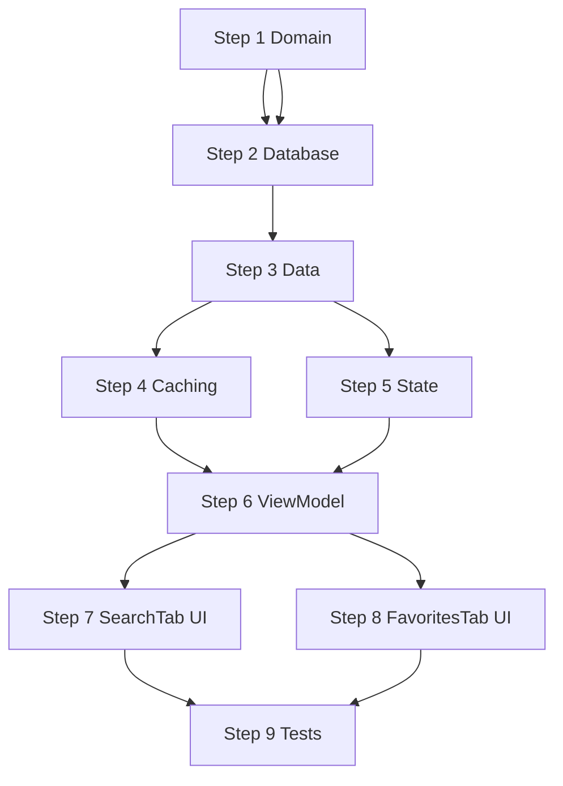

# Refinement Plan — Vereinheitlichte Suche & Favoriten im FoodPickerSheet

## Overview

Dieser Plan beschreibt die schrittweise Verbesserung des `FoodPickerSheet` zur
vereinheitlichten Suche nach Lebensmitteln und Rezepten, inklusive
Favoriten-Funktionalität und optimiertem Online-Caching.

### Workflow pro Step

Jeder Step folgt dem AGENTS.md-Workflow:

1. **Planning** — Analyse & Design
2. **Implementation** — Code schreiben
3. **Unit Tests** — Tests schreiben
4. **Integration Tests** — End-to-End testen
5. **Self Review** — Code-Qualität prüfen
6. **Architecture Explanation** — Entscheidungen dokumentieren
7. **Open Questions / Human in the Loop** — Unklarheiten klären
8. **Refinement** — Plan verfeinern
9. **Acceptance Check** — Prüfen ob alle Kriterien erfüllt
10. **Commit** — Nur nach explizitem Befehl vom User

---

### Design-Entscheidungen (vorab geklärt)

1. **`feature/food`-Suche bleibt erhalten** — `FoodSearchScreen` und
   `BarcodeScanScreen` bleiben als eigenständige Vollbild-Ansichten für den
   Food-Tab in der Bottom-Navigation. Das FoodPickerSheet wird nur im
   Diary/Recipe-Kontext genutzt.

2. **MyFoodsTab → FavoritenTab** — Der Tab zeigt ausschließlich als Favorit
   markierte Lebensmittel und Rezepte (nicht mehr alle lokalen Einträge).
   Segmented-Button zum Wechseln zwischen Food/Recipe.

3. **Rezepte in separater Sektion** — In den lokalen Suchergebnissen werden
   Rezepte in einem eigenen Abschnitt unter den Lebensmitteln angezeigt.

4. **SearchTab beim Öffnen: nur Recent** — Keine Favoriten-Sektion im
   SearchTab. Beim Öffnen werden nur zuletzt verwendete Items (Food +
   Recipe) gezeigt.

5. **BarcodeTab bleibt** — Funktioniert in aktueller Form, wird nicht
   entfernt.

6. **Online-Caching nur bei Nutzung** — Von OpenFoodFacts geladene
   Ergebnisse werden nicht automatisch gecached, sondern erst wenn der
   Nutzer sie tatsächlich auswählt (in Tagebuch oder Rezept).

7. **Recipe-Favoriten separate Spalte** — Recipes bekommen eigene
   `is_favorite`/`last_used_at`-Spalten in der `recipes`-Tabelle (keine
   gemeinsame Favorites-Tabelle).

8. **Recipe-Suche ohne FTS** — Recipes werden per `name.contains(query)` im
   ViewModel gefiltert (geringe Anzahl, kein FTS nötig).

---

## 🔲 Step 1 — Domain: Recipe um Favoriten/Recency erweitern

### Ziel

`Recipe`-Domain-Modell um `isFavorite` und `lastUsedAt` ergänzen.
`RecipeRepository`-Interface um entsprechende Methoden erweitern.

### Änderungen

**`core/domain/model/Recipe.kt`**
- Neue Felder: `isFavorite: Boolean = false`, `lastUsedAt: Long? = null`
- `init`-Validierung: `lastUsedAt` non-negativ falls gesetzt

**`core/domain/repository/RecipeRepository.kt`**
```kotlin
fun observeFavorites(): Flow<List<Recipe>>
fun observeRecent(limit: Int = DEFAULT_RECENT_LIMIT): Flow<List<Recipe>>
suspend fun toggleFavorite(id: RecipeId): EmptyResult<DataError.Local>
suspend fun markUsed(id: RecipeId): EmptyResult<DataError.Local>
```

**`core/domain/datasource/RecipeLocalDataSource.kt`**
- Analoge Methoden: `observeFavorites()`, `observeRecent(limit)`,
  `setFavorite(id, favorite)`, `markUsed(id, usedAt)`

### Tests

- Recipe-Validierung: `isFavorite` nicht-null, `lastUsedAt` non-negativ
- FakeRecipeRepository-Update (feature/recipes + feature/foodpicker)

### Acceptance Criteria

- [ ] `Recipe` hat `isFavorite`-Feld (Default `false`)
- [ ] `Recipe` hat `lastUsedAt`-Feld (Default `null`)
- [ ] `RecipeRepository` bietet `observeFavorites()`, `observeRecent()`,
      `toggleFavorite()`, `markUsed()`
- [ ] `RecipeLocalDataSource` hat korrespondierende Methoden
- [ ] Bestehende Tests passen
- [ ] `./gradlew build` + `./gradlew detekt` + `./gradlew ktlintCheck` grün

---

## 🔲 Step 2 — Database: recipes-Tabelle erweitern

### Ziel

Neue Spalten in `RecipeEntity`, DAO-Methoden für Favoriten/Recent,
Migration v7→v8.

### Änderungen

**`core/database/entity/RecipeEntity.kt`**
- `is_favorite: Int = 0` (BOOLEAN als INTEGER)
- `last_used_at: Long? = null` (epoch millis)

**`core/database/dao/RecipeDao.kt`**
```kotlin
fun observeFavorites(): Flow<List<RecipeEntity>>
fun observeRecent(limit: Int): Flow<List<RecipeEntity>>
suspend fun setFavorite(id: String, favorite: Boolean)
suspend fun markUsed(id: String, usedAt: Long)
```

**`core/database/migration/Migrations.kt`**
- `MIGRATION_7_8`:
  - `ALTER TABLE recipes ADD COLUMN is_favorite INTEGER NOT NULL DEFAULT 0`
  - `ALTER TABLE recipes ADD COLUMN last_used_at INTEGER`
- `ALL_MIGRATIONS` um MIGRATION_7_8 ergänzen

**`core/database/EZDatabase.kt`**
- Version 7 → 8

### Tests

- Migration v7→v8 (Daten bleiben erhalten)
- DAO: `setFavorite` setzt Flag, `observeFavorites` filtert korrekt
- DAO: `markUsed` setzt Timestamp, `observeRecent` sortiert DESC

### Acceptance Criteria

- [ ] `recipes`-Tabelle hat Spalten `is_favorite` und `last_used_at`
- [ ] Migration v7→v8 funktioniert mit vorhandenen Daten
- [ ] DAO-Queries für Favoriten und Recent funktionieren
- [ ] Indizes auf `is_favorite` und `last_used_at` (bei Bedarf)
- [ ] Bestehende Tests passen
- [ ] `./gradlew build` + `./gradlew detekt` + `./gradlew ktlintCheck` grün

---

## 🔲 Step 3 — Data: Implementierung in Data-Layer

### Ziel

`RoomRecipeLocalDataSource` und `RoomRecipeRepository` implementieren die
neuen Methoden aus Step 1. Fakes in Tests aktualisieren.

### Änderungen

**`core/data/recipe/RoomRecipeLocalDataSource.kt`**
```kotlin
override fun observeFavorites(): Flow<List<Recipe>> =
    dao.observeFavorites().map { entities -> entities.map { it.toRecipeSuspending() } }

override fun observeRecent(limit: Int): Flow<List<Recipe>> =
    dao.observeRecent(limit).map { entities -> entities.map { it.toRecipeSuspending() } }

override suspend fun setFavorite(id: RecipeId, favorite: Boolean): EmptyResult<DataError.Local> =
    runCatchingLocal { dao.setFavorite(id.value, favorite) }

override suspend fun markUsed(id: RecipeId, usedAt: Long): EmptyResult<DataError.Local> =
    runCatchingLocal { dao.markUsed(id.value, usedAt) }
```

**`core/data/recipe/RoomRecipeRepository.kt`**
```kotlin
override fun observeFavorites(): Flow<List<Recipe>> = local.observeFavorites()
override fun observeRecent(limit: Int): Flow<List<Recipe>> = local.observeRecent(limit)
override suspend fun toggleFavorite(id: RecipeId): EmptyResult<DataError.Local> {
    // aktuellen Status lesen, invertieren
    val recipe = local.getById(id)
    return when (recipe) {
        is Result.Success -> local.setFavorite(id, !(recipe.data?.isFavorite ?: false))
        is Result.Error -> EmptyResult.Error(recipe.error)
    }
}
override suspend fun markUsed(id: RecipeId): EmptyResult<DataError.Local> =
    local.markUsed(id, System.currentTimeMillis())
```

**Fakes aktualisieren:**
- `feature/recipes/presentation/src/test/.../FakeRepositories.kt`
- `feature/foodpicker/presentation/...` — ggf. Fake für VM-Tests

### Tests

- `RoomRecipeRepository`: observeFavorites, observeRecent, toggleFavorite,
  markUsed
- Fakes verhalten sich korrekt

### Acceptance Criteria

- [ ] `RoomRecipeLocalDataSource` implementiert alle neuen Methoden
- [ ] `RoomRecipeRepository` delegiert korrekt
- [ ] `toggleFavorite` invertiert den aktuellen Status
- [ ] `markUsed` setzt aktuellen Timestamp
- [ ] Bestehende Tests passen
- [ ] `./gradlew build` + `./gradlew detekt` + `./gradlew ktlintCheck` grün

---

## 🔲 Step 4 — Online-Caching: Nur bei Nutzung speichern

### Ziel

`OfflineFirstFoodRepository.searchRemote()` cached nicht mehr automatisch.
Neue Methode `cacheRemoteItem()` zum gezielten Cachen bei Nutzung.

### Änderungen

**`core/domain/repository/FoodRepository.kt`**
```kotlin
suspend fun cacheRemoteItem(item: FoodItem): EmptyResult<DataError.Local>
```

**`core/data/food/OfflineFirstFoodRepository.kt`**
- `searchRemote()`: entferne `cacheWithoutOverwritingUserEdits()` — nur
  noch Remote-Call + Return der gemappten Items
- Neue Methode `cacheRemoteItem(item)`:
  - Speichert Item mit `cachedStatus = Original`
  - Setzt `originalSnapshot = itself` (für Reset-Möglichkeit)
  - Überschreibt nicht, wenn lokal `UserModified` (ADR-004)
  - Ruft `markUsed(item.id)` auf

**Fakes aktualisieren:**
- `feature/food/presentation/src/test/.../FakeFoodRepository.kt`
- `feature/recipes/presentation/src/test/.../FakeRepositories.kt`

### Tests

- `OfflineFirstFoodRepository`: `searchRemote` cached nicht mehr automatisch
- `OfflineFirstFoodRepository`: `cacheRemoteItem` speichert + markAsUsed
- ADR-004: `cacheRemoteItem` überschreibt `UserModified` nicht

### Acceptance Criteria

- [ ] `searchRemote()` returned Ergebnisse ohne sie zu cachen
- [ ] `cacheRemoteItem()` cached ein einzelnes Item + ruft `markUsed()` auf
- [ ] ADR-004 wird eingehalten (UserModified nicht überschreiben)
- [ ] Bestehende Tests passen
- [ ] `./gradlew build` + `./gradlew detekt` + `./gradlew ktlintCheck` grün

---

## 🔲 Step 5 — State: FoodPickerState & PickerRecipeUi erweitern

### Ziel

Neue State-Felder für Favoriten, Recent-Recipes und Recipe-Suchergebnisse.
`PickerRecipeUi` um `isFavorite` ergänzt.

### Änderungen

**`feature/foodpicker/.../picker/FoodPickerState.kt`**

```kotlin
data class PickerRecipeUi(
    val id: String,
    val name: String,
    val kcalPer100g: Double,
    val isFavorite: Boolean,   // NEU
)

data class FoodPickerState(
    // Bestehende Felder bleiben
    val recentFoods: List<PickerFoodUi> = emptyList(),
    val recentRecipes: List<PickerRecipeUi> = emptyList(),          // NEU
    val localSearchResults: List<PickerFoodUi> = emptyList(),
    val localRecipeResults: List<PickerRecipeUi> = emptyList(),     // NEU
    val onlineSearchResults: List<PickerFoodUi> = emptyList(),
    val isSearchingOnline: Boolean = false,
    val onlineError: UiText? = null,
    val userFoods: List<PickerFoodUi> = emptyList(),
    val userRecipes: List<PickerRecipeUi> = emptyList(),
    val favoriteFoods: List<PickerFoodUi> = emptyList(),            // NEU
    val favoriteRecipes: List<PickerRecipeUi> = emptyList(),        // NEU
    val showFoods: Boolean = true,
    // restliche Felder unverändert
)

enum class FoodPickerTab { BARCODE, SEARCH, FAVORITES }  // MY_FOODS → FAVORITES
```

**Mapper aktualisieren:**
```kotlin
fun Recipe.toPickerRecipeUi() = PickerRecipeUi(
    id = id.value,
    name = name,
    kcalPer100g = nutritionPer100g()?.kcal ?: 0.0,
    isFavorite = isFavorite,   // NEU
)
```

### Acceptance Criteria

- [ ] `PickerRecipeUi` hat `isFavorite`-Feld
- [ ] `FoodPickerState` hat `favoriteFoods`, `favoriteRecipes`,
      `recentRecipes`, `localRecipeResults`
- [ ] `FoodPickerTab.MY_FOODS` → `FoodPickerTab.FAVORITES`
- [ ] `./gradlew build` + `./gradlew detekt` + `./gradlew ktlintCheck` grün

---

## 🔲 Step 6 — ViewModel: Neue Observes + Logik

### Ziel

ViewModel beobachtet Favoriten/Recent für Food und Recipe, sucht lokal
nach Recipes, handled `markUsed` und `toggleFavorite` für beide Typen,
sowie `cacheRemoteItem` bei Online-Auswahl.

### Änderungen

**`feature/foodpicker/.../picker/FoodPickerViewModel.kt`**

Neue Observes im `init`:
```kotlin
private fun observeFavoriteFoods() {
    foodRepository.observeFavorites()
        .onEach { foods -> _state.update { it.copy(favoriteFoods = foods.map { f -> f.toPickerFoodUi() }) } }
        .launchIn(viewModelScope)
}

private fun observeFavoriteRecipes() {
    recipeRepository.observeFavorites()
        .onEach { recipes -> _state.update { it.copy(favoriteRecipes = recipes.map { r -> r.toPickerRecipeUi() }) } }
        .launchIn(viewModelScope)
}

private fun observeRecentRecipes() {
    recipeRepository.observeRecent()
        .onEach { recipes -> _state.update { it.copy(recentRecipes = recipes.map { r -> r.toPickerRecipeUi() }) } }
        .launchIn(viewModelScope)
}
```

Lokale Recipe-Suche:
```kotlin
@OptIn(ExperimentalCoroutinesApi::class)
private fun observeLocalRecipeResults() {
    queryFlow
        .flatMapLatest { query ->
            if (query.isBlank()) flowOf(emptyList())
            else recipeRepository.observeAll().map { recipes ->
                recipes
                    .filter { it.name.contains(query, ignoreCase = true) }
                    .map { it.toPickerRecipeUi() }
            }
        }
        .onEach { recipes -> _state.update { it.copy(localRecipeResults = recipes) } }
        .launchIn(viewModelScope)
}
```

`onFoodClick` erweitern:
```kotlin
private fun onFoodClick(foodId: String) {
    viewModelScope.launch {
        // Prüfen ob Item aus Online-Ergebnissen stammt (noch nicht lokal)
        val onlineItem = _state.value.onlineSearchResults.firstOrNull { it.id == foodId }
        // Item als genutzt markieren
        foodRepository.markUsed(FoodId(foodId))
        // Rest wie gehabt
    }
}
```

`OnToggleFavorite` differenzieren:
```kotlin
is FoodPickerAction.OnToggleFavorite -> {
    viewModelScope.launch {
        // Prüfen ob es ein Recipe oder Food ist
        val isRecipe = _state.value.userRecipes.any { it.id == action.foodId } ||
            _state.value.favoriteRecipes.any { it.id == action.foodId }
        if (isRecipe) {
            recipeRepository.toggleFavorite(RecipeId(action.foodId))
        } else {
            foodRepository.toggleFavorite(FoodId(action.foodId))
        }
    }
}
```

### Acceptance Criteria

- [ ] Favoriten (Food + Recipe) werden in State geladen
- [ ] Recent-Recipes werden in State geladen
- [ ] Lokale Recipe-Suche filtert nach Query
- [ ] `markUsed()` wird bei Food/Recipe-Auswahl aufgerufen
- [ ] `toggleFavorite` erkennt Food vs. Recipe korrekt
- [ ] `cacheRemoteItem()` bei Online-Auswahl (nicht bei Selection)
- [ ] Bestehende Tests passen
- [ ] `./gradlew build` + `./gradlew detekt` + `./gradlew ktlintCheck` grün

---

## 🔲 Step 7 — UI: SearchTab mit Recipes

### Ziel

RecentSection zeigt auch Rezepte. Lokale Suchergebnisse haben separate
Recipe-Sektion.

### Änderungen

**`feature/foodpicker/.../picker/search/SearchTab.kt`**

`RecentSection`:
- Nach `recentFoods` auch `recentRecipes` in eigenem Abschnitt
- Nur sichtbar wenn query leer ist

`SearchResultsSection`:
- Nach lokalen Foods eine neue Recipe-Sektion mit `localRecipeResults`
- Rezepte haben eigene `RecipeRow` (Name, kcal, Favorite-Stern)
- Recipe-Klick → `FoodPickerAction.OnRecipeClick`

Neue Composables:
```kotlin
@Composable
private fun RecipeRow(
    recipe: PickerRecipeUi,
    onAction: (FoodPickerAction) -> Unit,
) {
    // Analog zu FoodRow: Name, kcal/100g, Favorite-Stern
    // Klick → OnRecipeClick, Favorite → OnToggleFavorite
}
```

### Acceptance Criteria

- [ ] RecentSection zeigt recentRecipes unter recentFoods
- [ ] SearchResultsSection zeigt Recipe-Ergebnisse in separater Sektion
- [ ] RecipeRow hat Favorite-Stern (toggle)
- [ ] Klick auf Recipe → `OnRecipeClick` Action
- [ ] Bestehende UI-Tests passen
- [ ] `./gradlew build` + `./gradlew detekt` + `./gradlew ktlintCheck` grün

---

## 🔲 Step 8 — UI: MyFoodsTab → FavoritesTab

### Ziel

Tab zeigt NUR Favoriten (Lebensmittel + Rezepte). Segmented-Button zum
Wechseln. Tab umbenennen zu "Favoriten".

### Änderungen

**`feature/foodpicker/.../picker/FoodPickerSheet.kt`**
- Tab-Label änderung: `FoodPickerTab.FAVORITES` → String-Resource
  `foodpicker_tab_favorites`

**`feature/foodpicker/.../picker/FoodPickerAction.kt`**
- Keine Änderung nötig (`OnMyFoodsToggle` bleibt)

**`feature/foodpicker/.../picker/myfoods/MyFoodsTab.kt`**
- Umbenannt → `FavoritesTab.kt` (oder Package-Umzug)
- `foods` → aus `state.favoriteFoods`
- `recipes` → aus `state.favoriteRecipes`
- Leerer-Zustand: "Keine Favoriten" (String-Resource)

**Strings (`feature/foodpicker/.../res/values/strings.xml`)**
- `foodpicker_tab_favorites` = "Favoriten"
- `foodpicker_favorites_empty` = "Keine Favoriten"
- Altes `foodpicker_tab_my_foods` entfernen oder umbenennen

### Acceptance Criteria

- [ ] Tab heißt "Favoriten" (nicht mehr "Meine Lebensmittel")
- [ ] Tab zeigt NUR als Favorit markierte Items
- [ ] Segmented-Button wechselt zwischen Favorit-Foods und Favorit-Recipes
- [ ] Leerer Zustand zeigt "Keine Favoriten"
- [ ] Bestehende UI-Tests passen
- [ ] `./gradlew build` + `./gradlew detekt` + `./gradlew ktlintCheck` grün

---

## 🔲 Step 9 — Tests

### Ziel

Unit-Tests für neue ViewModel-Logik, Repository-Tests für Recipe-Features,
Integrationstests für Caching-Änderung.

### Tests

**`feature/foodpicker/.../picker/FoodPickerViewModelTest.kt`**
- `observeFavoriteFoods` lädt Favoriten in State
- `observeFavoriteRecipes` lädt Recipe-Favoriten in State
- `observeRecentRecipes` lädt recent Recipes
- `OnToggleFavorite` ruft `foodRepository.toggleFavorite` für Food-Ids
- `OnToggleFavorite` ruft `recipeRepository.toggleFavorite` für Recipe-Ids
- `markUsed` bei Food-Auswahl
- `markUsed` bei Recipe-Auswahl
- `localRecipeResults` filtert Recipes nach Query
- `searchOnline` cached nicht automatisch

**`core/data/.../OfflineFirstFoodRepositoryTest.kt`**
- `searchRemote` cached nicht mehr
- `cacheRemoteItem` speichert + markUsed
- ADR-004: `cacheRemoteItem` überschreibt `UserModified` nicht

**`core/data/.../RoomRecipeRepositoryTest.kt`**
- `observeFavorites` gibt nur Favoriten zurück
- `observeRecent` sortiert nach `lastUsedAt` DESC
- `toggleFavorite` invertiert Flag
- `markUsed` setzt Timestamp

### Acceptance Criteria

- [ ] Alle neuen ViewModel-Tests grün
- [ ] Repository-Tests für Recipe-Favoriten/Recent grün
- [ ] Caching-Tests: searchRemote cached nicht, cacheRemoteItem speichert
- [ ] Bestehende Tests weiterhin grün
- [ ] `./gradlew build` + `./gradlew detekt` + `./gradlew ktlintCheck` grün

---

## Cross-Step Dependencies



**Key Dependencies:**
- **Step 1–3** (Domain/Database/Data) sind Voraussetzung für alles Weitere
- **Step 4** (Caching) kann parallel zu Step 5 laufen
- **Step 5+6** (State+ViewModel) bauen auf Steps 1–3 auf + Step 4
- **Step 7+8** (UI) sind unabhängig voneinander, bauen auf Step 6 auf
- **Step 9** (Tests) erst nach allen Implementierungs-Steps

---

## Shared Requirements

### Architecture Adherence
- Alle Änderungen folgen Clean Architecture
- Dependency Direction: `app → feature → core → domain`
- Feature-Module bleiben unabhängig voneinander
- Domain hat KEINE Android-Abhängigkeiten

### Code Quality
- `./gradlew detekt` muss grün sein
- `./gradlew ktlintCheck` muss grün sein
- `./gradlew build` muss grün sein
- Keine TODOs im Code (nur im Plan)
- Type Safety und Null Safety erhalten

### Testing
- Unit Tests für alle Domain-Logik
- Integrationstests für End-to-End-Flows
- ViewModel-Tests mit Turbine + UnconfinedTestDispatcher
- Bestehende Tests müssen weiterhin passen

### Commit-Regel
Niemals automatisch committen. Erst nach explizitem Befehl vom User
(`Commit Phase X`).

---

**Document Version:** 3.0
**Created:** 2026-07-30
**Project:** EZ Makro Phase 9 Refinement — Unified Search & Favorites
**Status:** Planning abgeschlossen, bereit zur Implementierung
