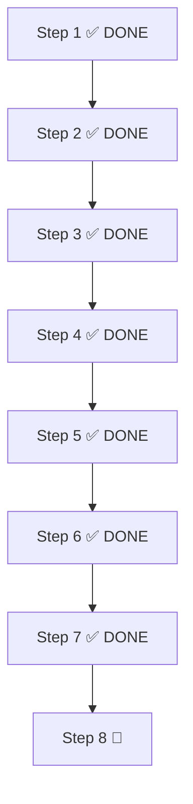

# Refinement Plan - Phase 9 Implementation

## Overview

This document outlines the incremental refinement implementation plan for Phase 9 of the EZ Makro project. The plan follows the AGENTS.md development workflow and executes the refinement requirements across multiple development sessions.

### Architektur-Update: Immer per 100g

**Kernentscheidung:** Intern werden Nährwerte IMMER pro 100g gespeichert.
- Beim Erstellen eines Lebensmittels gibt der User immer die Nährwerte pro 100g an (Pflichtfeld)
- Optional kann zusätzlich eine Portionsgröße in Gramm angegeben werden
- Beim Loggen im Tagebuch oder Rezept wird aus den per-100g-Werten + Portionsgröße gerechnet
- Beispiel: Apfel mit 52 kcal pro 100g, Portionsgröße = 120g → eine Portion = 62,4 kcal
- `ServingUnit`-Label wird auto-generiert (z. B. `"1 Portion (120g)"`)
- ADR-003 (Rohgewicht vs. Endgewicht) gilt weiterhin unverändert

### Workflow pro Step

Jeder Step folgt dem AGENTS.md-Workflow:

1. **Planning** — Analyse & Design
2. **Implementation** — Code schreiben
3. **Unit Tests** — Tests schreiben
4. **Integration Tests** — End-to-End testen
5. **Self Review** — Code-Qualität prüfen
6. **Architecture Explanation** — Entscheidungen dokumentieren
7. **Open Questions / Human in the Loop** — Unklarheiten klären
8. **Refinement** — Plan verfeinern
9. **Acceptance Check** — Prüfen ob alle Kriterien erfüllt
10. **Commit** — Nur nach explizitem Befehl vom User

---

## ✅ Step 1 (DONE) — Food Creation: Per-100g optional

**Commit:** `e1f0498`

### Was gemacht wurde
- `FoodItem.nutritionPer100g: NutritionValues` → `NutritionValues?` (optional/nullable)
- FoodEditScreen erlaubt Speichern ohne Nährwerte
- UI zeigt "–" wenn keine Nährwerte vorhanden
- DB-Migration 3→4: `nutri_*`-Spalten nullable
- `RecipeCalculation` fallback auf `NutritionValues.ZERO` bei null
- Neue Tests: `saveWithoutPer100g`, `null nutritionPer100g` in Calculation

### Files
- `core/domain/model/FoodItem.kt`
- `feature/food/presentation/edit/FoodEditViewModel.kt`
- `feature/food/presentation/model/FoodUi.kt`
- `core/data/food/mapper/FoodItemEntityMapper.kt`
- `core/data/food/RoomFoodLocalDataSource.kt`
- `core/data/recipe/RoomRecipeLocalDataSource.kt`
- `core/domain/calculation/RecipeCalculation.kt`
- `core/database/entity/FoodItemEntity.kt`
- `core/database/dao/FoodItemDao.kt`
- `core/database/migration/Migrations.kt`

---

## ✅ Step 2 (DONE) — Recipe Diary Entry Enhancement

### Was gemacht wurde
- Diary unterstützt für Recipes sowohl `amountGrams` als auch `portionCount`
- `DiaryEntry`: Recipes können per Gramm ODER Portion geloggt werden
- Diary-UI: Auswahl zwischen Portionen und Gramm bei Rezept-Eintrag
- AddToDiaryUseCases verarbeiten beide Modi

### Files
- `core/domain/model/DiaryEntry.kt`
- `core/domain/usecase/diary/AddToDiaryUseCases.kt`
- `core/data/diary/mapper/DiaryEntryEntityMapper.kt`
- `feature/diary/presentation/day/DiaryDayViewModel.kt`
- `feature/diary/presentation/day/DiaryDayScreen.kt`
- `feature/diary/presentation/model/DiaryUi.kt`

---

## 🔲 Step 3 — Portionsgröße & Per-100g-Vereinheitlichung

### Ziel
Das UI für Lebensmittel-Erstellung auf die neue Architektur ("immer per 100g") umstellen. Foods UND Recipes im Tagebuch sollen per `portionCount` loggbar sein (wenn `servingUnit` gesetzt).

### Problem
- `nutritionPer100g` ist aktuell nullable (Step 1) — soll aber im Normalfall immer eingegeben werden
- Foods können NICHT per `portionCount` geloggt werden (nur Recipes)
- `FoodEditScreen` hat kein Feld für Portionsgröße in Gramm

### Lösung
1. **FoodEditScreen umbauen:**
   - Nährwerte pro 100g sind das primäre/zentrale Eingabefeld
   - Zusätzlich: optionales Feld "Portionsgröße in Gramm"
   - `ServingUnit` wird aus Gramm-Zahl auto-generiert (`"1 Portion (120g)"`)
   - Beim Bearbeiten: bestehende `servingUnit` in Gramm-Zahl umwandeln

2. **DiaryEntry erweitern:**
   - Foods dürfen `portionCount` setzen (wenn `servingUnit` != null)
   - Foods müssen nicht zwingend `amountGrams` setzen (dürfen auch `portionCount`)
   - Validierung: `food.servingUnit != null` für `portionCount` bei Food

3. **Diary-UI anpassen:**
   - Beim Hinzufügen eines Foods: Auswahl zwischen Gramm und Portionen
   - Portionen-Auswahl nur wenn `servingUnit` gesetzt

### Betroffene Files
- `feature/food/presentation/edit/FoodEditScreen.kt` — UI umbauen
- `feature/food/presentation/edit/FoodEditViewModel.kt` — Portionsgröße-Logik
- `feature/food/presentation/edit/FoodEditState.kt` — State erweitern
- `core/domain/model/DiaryEntry.kt` — Food darf `portionCount` setzen
- `core/domain/model/FoodItem.kt` — ggf. Revert nullable → required (oder als `require`-Nur-im-Normalfall belassen)
- `core/domain/calculation/DayNutrition.kt` — Berechnung für Food-Portionen
- `feature/diary/presentation/day/DiaryDayViewModel.kt` — Portion-Logik beim Hinzufügen
- `feature/diary/presentation/day/DiaryDayScreen.kt` — Gramm/Portion-Auswahl
- `core/presentation/diary/AddToDiarySheet.kt` — Portion-Auswahl
- `core/data/diary/mapper/DiaryEntryEntityMapper.kt` — erweiterte Logik

### Tests
- Food-Portion-Berechnung (per-100g × gramsEquivalent / 100)
- Diary-Eintrag mit `portionCount` für Food
- Validierung: `servingUnit` muss gesetzt sein für Food-Portion
- UI: Gramm/Portion-Auswahl sichtbar/nicht sichtbar

### Acceptance Criteria
- ✅ FoodEditor zeigt per-100g-Felder als primäre Eingabe + optional "Portionsgröße (g)"
- ✅ `ServingUnit` wird aus Gramm-Zahl auto-generiert
- ✅ Foods können per `portionCount` im Tagebuch geloggt werden
- ✅ Berechnung: Portion-Makros = `nutritionPer100g × gramsEquivalent / 100`
- ✅ Diary-UI zeigt Auswahl Gramm/Portion beim Food-Hinzufügen
- ✅ Bestehende Tests passen weiterhin
- ✅ `./gradlew build` + `./gradlew detekt` + `./gradlew ktlintCheck` grün

---

## 🔲 Step 4 — Enhanced Diary UI (Collapsible Entries)

### Ziel
Die Tagebuch-Übersicht zeigt nur Makro-Zusammenfassungen pro Mahlzeit. Beim Antippen einer Mahlzeit werden die Details sichtbar (einzelne Lebensmittel mit Makros). Einträge sind editierbar (Menge ändern, löschen).

### Problem
- DiaryDayScreen zeigt alle Einträge als flache Liste
- Keine Expand/Collapse-Funktionalität
- Keine Makro-Details pro Lebensmittel in der Übersicht
- Keine Edit-Funktion für Einträge

### Lösung
1. **Neue Composables:**
   - `CollapsibleMealSlot`: Mahlzeit mit Makro-Zusammenfassung + Expand-Button
   - `DiaryEntryDetail`: Zeigt Makros pro Lebensmittel/Rezept + Edit/Delete-Buttons
   - `EditPortionDialog`: Dialog zum Ändern der Menge (Gramm/Portion)

2. **State erweitern:**
   - `DiaryDayState` um `expandedSlots: Set<MealSlot>`
   - `DiaryDayViewModel` um Expand/Collapse-Actions

3. **Edit/Delete:**
   - Delete: bereits vorhanden (DeleteConfirmDialog)
   - Edit: neuer Dialog/Sheet für Mengen-Änderung
   - Nach Edit: `updateEntry` im Repository aufrufen

### Betroffene Files
- `feature/diary/presentation/day/DiaryDayScreen.kt` — Haupt-UI-Redesign
- `feature/diary/presentation/day/DiaryDayState.kt` — `expandedSlots` + Edit-State
- `feature/diary/presentation/day/DiaryDayAction.kt` — Expand/Collapse/Edit-Actions
- `feature/diary/presentation/day/DiaryDayEvent.kt` — ggf. neue Events
- `feature/diary/presentation/day/DiaryDayViewModel.kt` — neue Actions verarbeiten
- `feature/diary/presentation/model/DiaryUi.kt` — ggf. neue UI-Modelle
- `core/presentation/diary/` — neue Composables
- `core/domain/repository/DiaryRepository.kt` — ggf. `updateEntry`
- `core/domain/usecase/diary/` — ggf. neuer UseCase

### Tests
- DiaryDayViewModel: Expand/Collapse-State
- DiaryDayViewModel: Edit-Menge-Update
- UI: Collapsible verhalten sich korrekt
- UI: Edit-Dialog öffnet/schließt

### Acceptance Criteria
- ✅ Makro-Zusammenfassung pro Mahlzeit (kcal, Protein, Fett, KH, Ballaststoffe)
- ✅ Expand/Collapse pro Mahlzeit mit Animation
- ✅ Detail-Ansicht mit jedem Lebensmittel + Makros + Menge
- ✅ Editieren der Menge pro Eintrag (Gramm/Portion)
- ✅ Löschen pro Eintrag (bereits vorhanden)
- ✅ Alle Tests grün
- ✅ `./gradlew build` + `./gradlew detekt` + `./gradlew ktlintCheck` grün

---

## 🔲 Step 5 — Date Navigation

### Ziel
Im Tagebuch können Tage vor und zurück gewechselt werden. Future-Entries und Vergangenheits-Änderungen sind möglich. Default beim Öffnen ist der aktuelle Tag. Navigation auch vom Dashboard aus.

### Problem
- Diary zeigt nur den aktuellen Tag (kein Wechsel möglich)
- Keine Möglichkeit Future-Entries zu erfassen
- Kein Datums-Sprung aus History/Dashboard
- `DiaryDayViewModel` lädt festes Datum aus `SavedStateHandle`

### Lösung
1. **Navigation UI:**
   - Prev/Next-Pfeile in der TopAppBar
   - Datum-Anzeige zwischen den Pfeilen
   - Antippen des Datums → DatePicker oder Kalender

2. **ViewModel:**
   - `date` wird über Action geändert (nicht nur init)
   - `onAction(OnPreviousDay)`, `onAction(OnNextDay)`, `onAction(OnGoToDate(date))`
   - Flow wird bei Datums-Wechsel neu gestartet

3. **Routing:**
   - History → Day: `navigate("diary/day/$date")`
   - Dashboard → Day: `navigate("diary/day/$date")`
   - Nav-Back kehrt zum vorherigen Datum zurück

4. **Dashboard-Integration:**
   - Dashboard zeigt aktuellen Tag + Makros
   - Klick auf Tag → öffnet Diary an diesem Datum
   - Dashboard hat auch Prev/Next

### Betroffene Files
- `feature/diary/presentation/day/DiaryDayViewModel.kt` — date-Änderungen verarbeiten
- `feature/diary/presentation/day/DiaryDayScreen.kt` — Navigation UI (Pfeile, Datum)
- `feature/diary/presentation/day/DiaryDayAction.kt` — neue Navigation-Actions
- `feature/diary/presentation/day/DiaryDayState.kt` — aktuelles Datum
- `feature/diary/presentation/navigation/DiaryRoutes.kt` — Routing
- `feature/diary/presentation/history/HistoryViewModel.kt` — Jump-to-Date
- `core/domain/datasource/DiaryLocalDataSource.kt` — datums-basierte Queries
- `core/data/diary/RoomDiaryLocalDataSource.kt` — datums-basierte Queries
- `feature/dashboard/presentation/DashboardScreen.kt` — Tag-Navigation
- `feature/dashboard/presentation/DashboardViewModel.kt` — Tag-Wechsel

### Tests
- DiaryDayViewModel: date-Wechsel via Action
- DiaryDayViewModel: Neuladen bei Datums-Wechsel
- Navigation: prev/next ändert den State korrekt
- Dashboard: Klick auf Tag öffnet Diary an dem Datum

### Acceptance Criteria
- ✅ Prev/Next-Pfeile im Diary ändern den Tag
- ✅ Datum wird in der TopAppBar angezeigt
- ✅ Klick auf Datum → DatePicker (optional)
- ✅ Future-Entries sind möglich
- ✅ Vergangenheits-Änderungen sind möglich
- ✅ Default beim Öffnen: aktueller Tag
- ✅ Dashboard hat Navigation zum Diary mit korrektem Datum
- ✅ History → Day funktioniert
- ✅ Alle Tests grün
- ✅ `./gradlew build` + `./gradlew detekt` + `./gradlew ktlintCheck` grün

---

## 🔲 Step 6 — Recipe-as-Ingredient (Snapshot Independence)

### Ziel
Rezepte sollen als Zutat in anderen Rezepten verwendet werden können (z. B. Pizzateig in Pizza mit Toppings). Dabei sind sie unabhängig: Wenn das innere Rezept geändert oder gelöscht wird, bleibt das äußere Rezept unverändert.

### Architektur
**Referenz + Snapshot:** Die Nährwerte werden beim Hinzufügen eingefroren (Snapshot), zusätzlich bleibt eine Referenz auf das Original-Rezept. Die UI zeigt an, ob sich das Original geändert hat.

### Lösung
1. **Neues Domain-Modell: `RecipeSnapshot`:**
   ```kotlin
   data class RecipeSnapshot(
       val recipeId: RecipeId,
       val recipeName: String,
       val nutritionPer100g: NutritionValues,
       val originalLastModifiedAt: Long?,
   )
   ```

2. **`RecipeIngredient` erweitern:**
   ```kotlin
   data class RecipeIngredient(
       val food: FoodItem?,
       val recipeSnapshot: RecipeSnapshot?,
       val rawWeight: RawWeight?,
       val servingCount: Double?,
   )
   ```
   - `food` XOR `recipeSnapshot` (eines von beiden muss gesetzt sein)
   - `rawWeight` oder `servingCount` für Mengenangabe

3. **RecipeEditor anpassen:**
   - Zutaten-Picker zeigt auch Rezepte an
   - Beim Hinzufügen eines Rezepts: Snapshot erstellen (aktuelle Nährwerte + Name kopieren)
   - Menge kann als Gramm oder Portionen eingegeben werden
   - Portionen werden über per-100g + finalWeight/portions berechnet

4. **Snapshot-Aktualisierung (optional, später):**
   - UI-Badge "Original geändert" wenn `originalLastModifiedAt` vom aktuellen Recipe abweicht
   - Button "Snapshot aktualisieren"

### Betroffene Files
- `core/domain/model/RecipeSnapshot.kt` — NEU
- `core/domain/model/RecipeIngredient.kt` — erweitern
- `core/domain/model/Recipe.kt` — ggf. Anpassung
- `core/domain/model/DiaryEntry.kt` — recipe-Snapshot in Diary (optional)
- `core/domain/calculation/RecipeCalculation.kt` — Snapshot-Berechnung
- `core/data/recipe/mapper/RecipeEntityMapper.kt` — Snapshot persistieren
- `core/database/entity/RecipeEntity.kt` — Snapshot-Felder
- `core/database/dao/RecipeDao.kt` — ggf. Queries
- `feature/recipes/presentation/editor/RecipeEditorViewModel.kt` — Snapshot-Logik
- `feature/recipes/presentation/editor/RecipeEditorState.kt` — Snapshot-State
- `feature/recipes/presentation/editor/RecipeEditorScreen.kt` — Recipe-Picker
- `core/presentation/diary/AddToDiarySheet.kt` — ggf. Recipe-Snapshot

### Tests
- RecipeSnapshot: Erstellung + Aktualisierung
- RecipeIngredient: `food` XOR `recipeSnapshot`
- Berechnung: Snapshot-Nährwerte werden korrekt verwendet
- Independence: Änderung am Original ändert Snapshot NICHT
- UI: Recipe-Picker zeigt Recipes an

### Acceptance Criteria
- ✅ Recipe-Picker zeigt Recipes als Zutaten-Auswahl
- ✅ Beim Hinzufügen wird Snapshot erstellt (Nährwerte + Name)
- ✅ Änderungen am inneren Rezept beeinflussen äußeres NICHT
- ✅ Löschen des inneren Rezepts beeinflusst äußeres NICHT
- ✅ Menge kann als Gramm oder Rezept-Portionen eingegeben werden
- ✅ DB-Schema unterstützt Snapshot-Persistierung
- ✅ Migration für bestehende Recipes (Snapshot = null)
- ✅ Alle Tests grün
- ✅ `./gradlew build` + `./gradlew detekt` + `./gradlew ktlintCheck` grün

---

## ✅ Step 7 — Unified Food Interface Analysis (DONE)

### Ziel
Analysieren, ob und wie ein einheitliches Lebensmittel-Hinzufügen-Interface (ähnlich Foodvisor) implementiert werden soll. Ein Bottom-Sheet-Dialog über den ganzen Screen mit drei Tabs: Barcode, Suche, Meine Lebensmittel.

### Analyse
1. **Aktuelle Situation:**
    - Food hinzufügen: `FoodEditScreen`, `BarcodeScanScreen`, `FoodSearchScreen`
    - Recipe hinzufügen: `RecipeEditorScreen`
    - Diary hinzufügen: `AddToDiarySheet`, `QuickAddScreen`
    - Alle haben eigene Einstiegspunkte und UIs

2. **Option A: Refactor bestehender Interfaces**
    - `AddToDiarySheet` zum zentralen Bottom-Sheet ausbauen
    - Tabs: Barcode, Suche, Meine Lebensmittel
    - Vorteil: kein neues Modul nötig
    - Nachteil: Komplexität in `:core-presentation` steigt

3. **Option B: Neues Feature-Modul `:feature:foodpicker:presentation`**
    - Eigenes Modul nach Clean Architecture
    - Klare Trennung, wiederverwendbar
    - Vorteil: saubere Architektur
    - Nachteil: neues Modul, Aufwand

4. **Option C: Graduelle Migration**
    - Erst `AddToDiarySheet` ausbauen
    - Später in eigenes Modul auslagern
    - Vorteil: schneller erste Ergebnisse
    - Nachteil: temporäre Unschärfe

### Deliverables
- Vergleichsanalyse der Optionen
- Architecture Impact Assessment
- Risiko/Nutzen-Bewertung
- Detaillierte Empfehlung mit Begründung
- Aufwandsschätzung

### Ergebnis
- **Entscheidung: Option B** (Neues Modul `:feature:foodpicker:presentation`)
- Begründung: Architektur-Integrität, Wiederverwendbarkeit (auch für Recipe-Ingredient-Picker Step 6), saubere Barcode-Integration, vergleichbarer Aufwand zu Alternativen
- Aufwandsschätzung: 8.5–12.5 Tage

### Acceptance Criteria
- ✅ Analyse dokumentiert
- ✅ Empfehlung mit Begründung
- ✅ Aufwandsschätzung
- ✅ Entscheidung getroffen (Option B)

---

## 🔲 Step 8 — Unified Food Interface Implementation

### Ziel
Das neue Feature-Modul `:feature:foodpicker:presentation` implementieren: ein modal-bottom-sheet mit 3 Tabs (Barcode, Suche, Meine Lebensmittel) zum Hinzufügen von Lebensmitteln zum Tagebuch ODER als Rezept-Zutat.

### Übernahme aus Step 7 Analyse
- **Entscheidung:** Option B — Neues Clean-Architecture-Modul
- **Modulname:** `:feature:foodpicker:presentation` (analog zu bestehenden Features)
- **Ordner:** `feature/foodpicker/presentation/`
- **Wiederverwendbarkeit:** Sheet muss von DiaryDayScreen UND RecipeEditorScreen geöffnet werden können

### Architektur

```
:feature:foodpicker:presentation          ← NEU
  ├── picker/                             ← Hauptpaket
  │   ├── FoodPickerSheet.kt              ← ModalBottomSheet + TabRow (Root Composable)
  │   ├── FoodPickerViewModel.kt          ← Tab-State, Auswahl, Bestätigung
  │   ├── FoodPickerState.kt              ← Zustand
  │   ├── FoodPickerAction.kt             ← Actions
  │   ├── FoodPickerEvent.kt              ← Events
  │   ├── barcode/
  │   │   └── BarcodeTab.kt               ← Kamera-Preview + Scan-Overlay
  │   ├── search/
  │   │   └── SearchTab.kt                ← Recent/Local/Online-Suche
  │   └── myfoods/
  │       └── MyFoodsTab.kt               ← Food/Recipe-Toggle + Liste
  ├── di/
  │   └── FoodPickerModule.kt             ← Koin-Modul
```

### Abhängigkeiten
`:feature:foodpicker:presentation` benötigt:
- `:core:domain` — FoodItem, Recipe, DiaryEntry, MealSlot, UseCases, Repository-Interfaces
- `:core:presentation` — UiText, ObserveAsEvents, AddToDiarySheet (wird weiter genutzt ODER ersetzt)
- `:core:design-system` — Theme, LoadingIndicator, etc.
- `:core:barcode` — BarcodeScanner-Interface + MlKitBarcodeScanner
- CameraX (via libs.versions.toml Bundle)

### Detaillierte Aufgaben

#### 1. Modul-Setup
- `settings.gradle.kts`: `include(":feature:foodpicker:presentation")` hinzufügen
- `feature/foodpicker/presentation/build.gradle.kts` erstellen (analog `feature/food/presentation/build.gradle.kts`)
  - Plugins: `ezmakro.android.library`, `ezmakro.compose`, `ezmakro.koin`, `ezmakro.kotlinx.serialization`
  - Dependencies: `:core:domain`, `:core:presentation`, `:core:design-system`, `:core:barcode`, CameraX-Bundle
  - Namespace: `com.example.ezmakro.feature.foodpicker.presentation`
- Leeres `feature/foodpicker/presentation/src/main/java/com/example/ezmakro/feature/foodpicker/` Verzeichnis anlegen

#### 2. Domain-Grundlagen

Keine neuen Domain-Modelle nötig (wiederverwendet bestehende):
- `FoodItem`, `Recipe`, `MealSlot`, `DiaryEntry`
- `FoodRepository.observeAll()`, `FoodRepository.searchLocal()`, `FoodRepository.searchRemote()`
- `RecipeRepository.observeAll()`
- `AddFoodToDiaryUseCase`, `AddRecipeToDiaryUseCase`

#### 3. State (FoodPickerState.kt)
```kotlin
data class FoodPickerState(
    val activeTab: FoodPickerTab = FoodPickerTab.SEARCH,
    val searchQuery: String = "",
    val recentFoods: List<FoodUi> = emptyList(),
    val localSearchResults: List<FoodUi> = emptyList(),
    val onlineSearchResults: List<FoodUi> = emptyList(),
    val isSearchingOnline: Boolean = false,
    val onlineError: UiText? = null,
    val userFoods: List<FoodUi> = emptyList(),
    val userRecipes: List<RecipeUi> = emptyList(),
    val showFoods: Boolean = true,        // Toggle in "Meine Lebensmittel"
    val barcodeResult: String? = null,
    val isCameraPermissionGranted: Boolean = false,
    val isLookingUpBarcode: Boolean = false,
    val barcodeError: UiText? = null,
    val selectedItemReady: Boolean = false, // Food/Recipe selected → show AddToDiarySheet
    val selectedItemId: String? = null,
    val selectedItemIsRecipe: Boolean = false,
    val selectedItemHasServingUnit: Boolean = false,
    val targetContext: FoodPickerTarget = FoodPickerTarget.DIARY,
    val targetDate: String? = null,
    val isSheetVisible: Boolean = false,
)

enum class FoodPickerTab { BARCODE, SEARCH, MY_FOODS }

enum class FoodPickerTarget { DIARY, RECIPE_INGREDIENT }
```

#### 4. Actions (FoodPickerAction.kt)
```kotlin
sealed interface FoodPickerAction {
    data class OnTabSelected(val tab: FoodPickerTab) : FoodPickerAction
    data class OnSearchQueryChange(val query: String) : FoodPickerAction
    data object OnSearchOnlineClick : FoodPickerAction
    data class OnFoodClick(val foodId: String) : FoodPickerAction
    data class OnRecipeClick(val recipeId: String) : FoodPickerAction
    data object OnDismissSelection : FoodPickerAction
    data class OnConfirmAddToDiary(
        val slot: MealSlot, val amount: Double, val isGrams: Boolean,
    ) : FoodPickerAction
    data object OnMyFoodsToggle : FoodPickerAction  // switch foods/recipes
    data class OnBarcodeDetected(val barcode: String) : FoodPickerAction
    data class OnPermissionResult(val granted: Boolean) : FoodPickerAction
    data object OnDismiss : FoodPickerAction
}
```

#### 5. Events (FoodPickerEvent.kt)
```kotlin
sealed interface FoodPickerEvent {
    data class NavigateToFoodDetail(val foodId: String) : FoodPickerEvent
    data class NavigateToFoodCreate(val barcode: String?) : FoodPickerEvent
    data class AddToDiary(
        val itemId: String, val isRecipe: Boolean, val date: String,
        val slot: MealSlot, val amount: Double, val isGrams: Boolean,
    ) : FoodPickerEvent
    data class AddAsIngredient(
        val itemId: String, val isRecipe: Boolean,
    ) : FoodPickerEvent
    data object Dismissed : FoodPickerEvent
}
```

#### 6. ViewModel (FoodPickerViewModel.kt)
- Nutzt `FoodRepository` und `RecipeRepository` via Koin
- `observeAll()` für recent + userFoods + userRecipes
- `searchLocal(query)` und `searchRemote(query)` für Suche
- Barcode-Logik analog zu `BarcodeScanViewModel`
- Bei `OnConfirmAddToDiary`: Event feuern → Caller kümmert sich um persistieren
- State überlebt Config-Change via `SavedStateHandle` für Such-Query und Tab

#### 7. UI — FoodPickerSheet.kt (Root Composable)
```kotlin
@OptIn(ExperimentalMaterial3Api::class)
@Composable
fun FoodPickerSheet(
    isVisible: Boolean,
    target: FoodPickerTarget,
    targetDate: LocalDate?,
    onAddToDiary: (foodId: String, date: String, slot: MealSlot, amount: Double, isGrams: Boolean) -> Unit,
    onAddAsIngredient: (IngredientDraft) -> Unit,
    onDismiss: () -> Unit,
    viewModel: FoodPickerViewModel = koinViewModel(),
)
```

Implementierung:
- `ModalBottomSheet(onDismissRequest = onDismiss)` als Container
- `TabRow` mit 3 Tabs (Barcode, Suche, Meine Lebensmittel) + Icons
- Tab-Content via `when(state.activeTab)` dispatching
- Wenn `selectedItemReady == true`: `AddToDiarySheet` (aus `:core:presentation`) als Dialog overlay einblenden
- `ObserveAsEvents` für Navigation/AddToDiary-Events

#### 8. UI — BarcodeTab.kt
- Analog zu `BarcodeScanScreen` aber INLINE im Bottom-Sheet
- CameraPermission-Handling (PermissionLauncher)
- `BarcodeScanner` via Koin injecten (analog `BarcodeScanRoot`)
- Camera-Preview via `AndroidView` + `PreviewView`
- **ACHTUNG:** Camera-Preview in Bottom-Sheet ist technisch anspruchsvoll (Surface-Teardown bei Sheet-Resize). Lösung: `remember { PreviewView(context) }` außen halten, `Modifier.fillMaxWidth().height(300.dp)` feste Höhe für Preview-Bereich.
- Bei Barcode-Erkennung: ViewModel-Action aufrufen → lookup → bei Erfolg Food/Recipe auswählen

#### 9. UI — SearchTab.kt
- Analog zu `FoodSearchScreen` aber ohne TopAppBar (Tabs sind drin)
- `OutlinedTextField` für Query
- Online-Suche-Button (nur bei nicht-leerer Query)
- Ergebnisse: Recent (wenn Query leer) → Local Results → Online Results
- Klick auf Food → ViewModel.Action.OnFoodClick
- "Scan Barcode"-Button und "Create Own"-Button (analog FoodSearchScreen)
- Favoriten-Stern via `OnToggleFavorite`

#### 10. UI — MyFoodsTab.kt
- Switch/Toggle zwischen "Lebensmittel" und "Rezepte"
- `showFoods ? userFoods : userRecipes` in einer LazyColumn
- Klick → `OnFoodClick` oder `OnRecipeClick`
- Recipe-Klick: nur wenn `target == DIARY` (Recipe als Ingredient braucht ggf. eigene Logik — siehe Step 6 RecipeSnapshot)

#### 11. Integration in DiaryDayScreen
- `DiaryDayRoot` erhält neuen Parameter: `onOpenFoodPicker: () -> Unit`
- "Lebensmittel hinzufügen"-Button öffnet statt Navigation zu FoodSearch den FoodPicker-Sheet
- `FoodPickerSheet(isVisible, target=DIARY, targetDate, onAddToDiary, ...)` direkt im DiaryDayScreen-Composable
- `onAddToDiary`-Callback: bestehende `makeAddFoodToDiary`/`makeAddRecipeToDiary`-Logik aus `MainActivity` in ViewModel oder UseCase verschieben
- **Alternative (einfacher):** `onAddToDiary`-Event feuert → `MainActivity` macht wie bisher Repository + UseCase + popBackStack — aber statt `popBackStack` wird nur Sheet geschlossen

#### 12. Integration in RecipeEditorScreen
- `RecipeEditorRoot` erhält `onOpenFoodPicker: (IngredientDraft) -> Unit`-Callback
- "+ Zutat"-Button öffnet FoodPickerSheet mit `target = RECIPE_INGREDIENT`
- `onAddAsIngredient`-Callback: erzeugt `IngredientDraft` (mit FoodItem + Menge 100g default) und fügt zum RecipeEditor-State hinzu

#### 13. Navigation & DI in :app
- `AppModule.kt`: `foodPickerPresentationModule` einbinden
- `MainActivity.kt`: FoodPickerSheet wird NICHT über Navigation gesteuert — es ist ein Composable-Overlay in DiaryDayRoot/RecipeEditorRoot
- Keine neuen Navigationsrouten nötig (Sheet = Overlay, kein Screen)

#### 14. Entfernen alter Flows (optional, nach Integration)
- `food_search?addToDiaryDate=...` Route kann bestehen bleiben für Food-Tab-Navigation (normale Food-Suche ohne Add-to-Diary)
- `AddToDiarySheet` in `:core:presentation` bleibt erhalten (wird vom FoodPickerSheet weiter genutzt)
- `BarcodeScanScreen` in `feature:food` bleibt für Food-Tab erhalten
- **Nicht löschen** — nur der Diary-Einstieg wird auf FoodPickerSheet umgestellt

### Betroffene Dateien (Änderungen)

| Datei | Änderung |
|---|---|
| `settings.gradle.kts` | `include(":feature:foodpicker:presentation")` hinzufügen |
| `feature/foodpicker/presentation/build.gradle.kts` | **NEU** |
| `feature/foodpicker/presentation/.../*.kt` | **NEU** — 10+ Dateien (s.o.) |
| `app/src/main/java/.../di/AppModule.kt` | `foodPickerPresentationModule` einbinden |
| `app/src/main/java/.../MainActivity.kt` | FoodPicker-Result-Handling (Analog zu addFoodToDiary/addRecipeToDiary) |
| `feature/diary/presentation/.../DiaryDayAction.kt` | `OnOpenFoodPicker` Action hinzufügen |
| `feature/diary/presentation/.../DiaryDayEvent.kt` | ggf. Event anpassen |
| `feature/diary/presentation/.../DiaryDayViewModel.kt` | `onOpenFoodPicker`-Callback bereitstellen |
| `feature/diary/presentation/.../DiaryDayScreen.kt` | FoodPickerSheet einbetten, `onOpenFoodPicker`-Parameter |
| `feature/recipes/presentation/.../RecipeEditorAction.kt` | `OnOpenFoodPickerForIngredient` Action |
| `feature/recipes/presentation/.../RecipeEditorState.kt` | ggf. IngredientDraft-Handling |
| `feature/recipes/presentation/.../RecipeEditorViewModel.kt` | Ingredient-Auswahl-Handling |
| `feature/recipes/presentation/.../RecipeEditorScreen.kt` | FoodPickerSheet einbetten |

### Tests

| Test | Beschreibung |
|---|---|
| `FoodPickerViewModelTest` | Tab-Wechsel, Such-Query, Barcode-Detektion, Food/Recipe-Auswahl, ConfirmAddToDiary |
| `FoodPickerViewModelTest` | State-Überleben bei Config-Change (SavedStateHandle) |
| `DiaryDayViewModelTest` | FoodPicker öffnen → Item auswählen → Diary-Eintrag erstellt |
| `RecipeEditorViewModelTest` | FoodPicker öffnen → Ingredient auswählen → Ingredient im State |
| UI-Test (optional) | Tabs sichtbar/klickbar, Barcode-Permission-Dialog, Search-Ergebnisse |

### Acceptance Criteria
- ✅ `ModalBottomSheet` mit 3 Tabs: Barcode, Suche, Meine Lebensmittel
- ✅ Tab "Barcode": Kamera-Preview + Scan + Lookup
- ✅ Tab "Suche": Recent → lokal → online (OpenFoodFacts) + Favoriten
- ✅ Tab "Meine Lebensmittel": Switch Food/Recipe-Liste
- ✅ In allen 3 Tabs: Auswahl → AddToDiarySheet (Slot + Menge) → Diary-Eintrag
- ✅ Auswahl als Rezept-Zutat im RecipeEditor (Menge default 100g)
- ✅ Integration in DiaryDayScreen: "Hinzufügen"-Button öffnet Sheet statt Navigation
- ✅ Integration in RecipeEditorScreen: "+ Zutat"-Button öffnet Sheet
- ✅ Bestehende FoodSearchScreen/BarcodeScanScreen bleiben im Food-Tab erhalten
- ✅ State überlebt Config-Change (SavedStateHandle)
- ✅ `./gradlew build` + `./gradlew detekt` + `./gradlew ktlintCheck` grün
- ✅ Alle bestehenden Tests grün

---


## Cross-Step Dependencies



**Key Dependencies:**
- **Step 3** (portionsgröße) benötigt **Step 1+2** als Basis
- **Step 4** (collapsible UI) benötigt **Step 3** (Portion-Logik in Diary)
- **Step 5** (date nav) benötigt **Step 4** (aktuelle Diary-UI)
- **Step 6** (recipe-as-ingredient) kann parallel zu **Step 4+5** laufen
- **Step 7** (food interface analysis) abgeschlossen — Entscheidung: Option B
- **Step 8** (food interface implementation) baut auf Step 7 Analyse auf

---

## Shared Requirements

### Architecture Adherence
- Alle Änderungen folgen Clean Architecture
- Dependency Direction: `app → feature → core → domain`
- Feature-Module bleiben unabhängig voneinander
- Domain hat KEINE Android-Abhängigkeiten

### Code Quality
- `./gradlew detekt` muss grün sein
- `./gradlew ktlintCheck` muss grün sein
- `./gradlew build` muss grün sein
- Keine TODOs im Code (nur im Plan)
- Type Safety und Null Safety erhalten

### Testing
- Unit Tests für alle Domain-Logik
- Integrationstests für End-to-End-Flows
- ViewModel-Tests mit Turbine + UnconfinedTestDispatcher
- Bestehende Tests müssen weiterhin passen

### Commit-Regel
Niemals automatisch committen. Erst nach explizitem Befehl vom User (`Commit Phase X`).

---

**Document Version:** 2.1
**Created:** 2026-07-29
**Project:** EZ Makro Phase 9 Refinement
**Status:** Steps 1-7 DONE, Step 8 bereit zur Implementierung durch Coding-Agent
