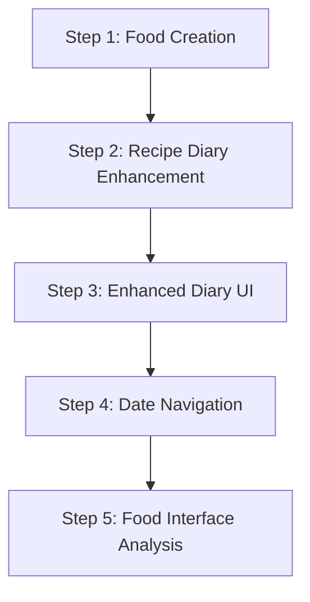

# Refinement Plan - Phase 9 Implementation

## Overview

This document outlines the incremental refinement implementation plan for Phase 9 of the EZ Makro project. The plan follows the AGENTS.md development workflow and executes the refinement requirements across multiple development sessions.

The implementation is staged into 5 steps:
1. **Food Creation Refactor** - Optional per-100g instead of dual calculation modes
2. **Recipe Diary Entry Enhancement** - Support portions OR weight for recipes
3. **Enhanced Diary UI** - Collapsible entries with macro details
4. **Date Navigation Implementation** - Past/future date access
5. **Unified Food Interface Analysis** - Planning for integrated food addition

---

## Development Workflow Integration

This plan follows the AGENTS.md workflow for each phase:

1. **Planning** - Analysis & design
2. **Implementation** - Code changes
3. **Unit Tests** - Test coverage
4. **Integration Tests** - End-to-end verification
5. **Self Review** - Quality assessment
6. **Architecture Explanation** - Design documentation
7. **Open Questions/Human in the Loop** - Risk discussion
8. **Refinement** - Requirements analysis
9. **Acceptance Check** - Final verification
10. **Commit** - Only after explicit approval

---

## Step 1: Food Creation Refactor - Optional Per-100g

### Problem Statement
Current food creation uses dual calculation modes (Portion vs Weight), which creates unnecessary complexity for users.

**Requirement:** Replace dual modes with a simple optional per-100g field, similar to how "pro 100g" works in the app.

### Files to Modify
- `core/domain/model/FoodItem.kt`
- `feature/food/presentation/*/FoodEditViewModel.kt`
- `feature/food/presentation/*/FoodEditScreen.kt`
- `core/data/*/FoodItemEntityMapper.kt`
- `core/data/*/dto/*.kt`

### Breaking Changes Analysis
| Layer | Impact | Severity |
|-------|--------|----------|
| **Domain** | FoodItem model modified | 🔴 High |
| **Presentation** | UI layer refactored | 🔴 High |
| **Data** | Entity mappers updated | 🔴 High |
| **Tests** | All tests affected | 🔴 High |

### Implementation Flow

#### Task 1: Planning (Session 1)
**Deliverables:**
- Architecture diagram showing food creation flow
- Detailed API changes table
- Migration matrix for breaking changes
- Test impact assessment

**Acceptance Criteria:**
- ✅ All modifications documented
- ✅ Breaking changes impact quantified
- ✅ Test strategy defined

#### Task 2: Implementation (Session 2)
**Implementation Tasks:**
- Add optional `per100g` field to FoodItem model
- Remove `RecipeCalculationMode` enum usage
- Simplify UI to single per-100g input field
- Update entity ↔ DTO conversion in mappers

**Code Quality Requirements:**
- Maintain type safety for calculations
- Preserve existing error handling
- Follow existing naming conventions
- Keep null safety intact

#### Task 3: Unit Tests (Session 3)
**Test Coverage Areas:**
- Domain: FoodItem validation, nutrition calculation
- Presentation: ViewModel state management
- Data: Entity mappers roundtrip testing

**Parallel Testing Strategy:**
- Domain tests can run independently
- Presentation tests require working domain
- Data tests depend on both layers

#### Task 4: Integration Tests (Session 4)
**Test Scenarios:**
- Complete food create/read/update flow
- Per-100g nutrition calculation validation
- Error handling for malformed input
- Cross-layer contract validation

#### Task 5: Self Review (Session 5)
**Quality Gates:**
- ✅ Code compiles without errors
- ✅ Linting/formatting passes (`./gradlew detekt`, `./gradlew ktlintCheck`)
- ✅ Architecture principles maintained
- ✅ All tests passing
- ✅ Breaking changes properly documented

#### Task 6: Architecture Explanation (Session 6)
**Documentation Requirements:**
- ADR for food creation simplification
- Decision rationale and alternatives
- Architecture impact assessment
- Migration considerations

#### Task 7: Open Questions/Human in the Loop (Session 7)
**Review Points:**
- User experience implications and testing
- Performance impact assessment
- Long-term maintenance considerations
- Regression risk evaluation

#### Task 8: Refinement Review (Session 8)
**Acceptance Criteria:**
- ✅ Food creation logic simplified per spec
- ✅ Per-100g optional functionality verified
- ✅ UI improvements confirmed and tested
- ✅ All requirements met

---

## Step 2: Recipe Diary Entry Enhancement - Portions OR Weight

### Problem Statement
Recipe diary entries currently support only portions for logging, but when recipes have per-100g nutrition, users need flexibility to log by weight as well.

**Requirement:** Support logging of recipes by portion count OR amount in grams.

### Files to Modify
- `core/domain/model/DiaryEntry.kt`
- `core/domain/calculation/RecipeCalculation.kt`
- `core/domain/usecase/diary/AddToDiaryUseCases.kt`
- `core/data/*/diary/DiaryEntryEntityMapper.kt`
- `feature/diary/presentation/*` (multiple files)

### Breaking Changes Analysis
| Layer | Impact | Severity |
|-------|--------|----------|
| **Domain** | DiaryEntry model expanded | 🔴 High |
| **Presentation** | Recipe diary UI modified | 🔴 High |
| **Data** | Entity contracts updated | 🔴 High |
| **Tests** | Integration tests heavily affected | 🔴 High |

### Implementation Flow

#### Task 1: Planning (Session 9)
**Deliverables:**
- Domain model changes documented
- UI flow diagrams for recipe diary
- Calculation logic specification
- Test impact analysis

**Acceptance Criteria:**
- ✅ Clear specification for modifications
- ✅ Risk assessment completed
- ✅ Migration plan defined

#### Task 2: Implementation (Session 10)
**Implementation Tasks:**
- Update DiaryEntry to allow amountGrams for recipes
- Modify RecipeCalculation to handle portion OR weight
- Update use cases to process new diary entry types
- Enhance UI with weight input option for recipes

#### Task 3-8: Follow Standard Workflow
*Execute Tasks 3-8 using the same pattern as Step 1 with appropriate acceptance criteria*

---

## Step 3: Enhanced Diary UI - Collapsible Entries

### Problem Statement
The diary UI currently shows a flat list of entries without macro details, making it difficult for users to understand nutritional content at a glance.

**Requirements:**
- Summary view showing only macro totals per meal slot
- Expand/collapse functionality to show individual food entries
- Display macro breakdown for each entry when expanded
- Edit/delete capabilities for individual entries
- Maintain compact overview while providing detailed access

### Files to Modify
- `core/presentation/diary/CollapsibleDiaryEntry.kt` (new)
- `feature/diary/presentation/day/DiaryDayScreen.kt`
- `feature/diary/presentation/day/DiaryDayViewModel.kt`
- `feature/diary/presentation/model/DiaryUi.kt`
- `core/presentation/diary/DiaryDayActions.kt` (new)

### Breaking Changes Analysis
| Layer | Impact | Severity |
|-------|--------|----------|
| **Presentation** | UI layer significantly updated | 🔴 High |
| **Core** | New design system components | 🟡 Medium |
| **Tests** | All diary presentation tests updated | 🔴 High |

### Implementation Flow

#### Task 1: Planning (Session 17)
**Deliverables:**
- UI component architecture documented
- Expand/collapse interaction design
- Component API specification
- Animation and performance considerations

**Acceptance Criteria:**
- ✅ UI architecture documented
- ✅ Interaction patterns specified
- ✅ Performance requirements defined

#### Task 2: Implementation (Session 18)
**New Components to Create:**
- **CollapsibleDiaryEntry**: Main expandable entry component
- **DiaryDayActions**: Action buttons (edit/delete)
- **Enhanced DiaryDayScreen**: Updated layout and behavior

**Implementation Tasks:**
- Create new composable functions
- Implement expand/collapse state management
- Add edit/delete interaction handlers
- Integrate with existing data flows

#### Task 3-8: Follow Standard Workflow
*Execute Tasks 3-8 using the same pattern as Step 1*

---

## Step 4: Date Navigation Implementation

### Problem Statement
Current diary navigation is limited to displaying only the current day's entries, preventing users from viewing or editing past or future dates.

**Requirements:**
- Previous/next date navigation buttons
- Date jumping from history/dashboard
- Current date as default when opening
- Support for creating entries in the future
- Maintain day-specific state and navigation

### Files to Modify
- `feature/diary/presentation/day/DiaryDayViewModel.kt`
- `feature/diary/presentation/history/HistoryViewModel.kt`
- `feature/diary/presentation/navigation/DiaryRoutes.kt`
- `core/domain/datasource/DiaryLocalDataSource.kt`

### Breaking Changes Analysis
| Layer | Impact | Severity |
|-------|--------|----------|
| **Domain** | Data layer enhanced | 🔴 High |
| **Presentation** | Navigation features added | 🔴 High |
| **Tests** | New integration scenarios needed | 🟡 Medium |

### Implementation Flow

#### Task 1: Planning (Session 23)
**Deliverables:**
- Navigation architecture documented
- Date picker implementation plan
- Cross-feature coordination design
- Performance optimization strategy

**Acceptance Criteria:**
- ✅ Navigation architecture specified
- ✅ Coordinate with existing routes
- ✅ Performance requirements defined

#### Task 2: Implementation (Session 24)
**Implementation Tasks:**
- Update ViewModels to handle date parameter
- Implement navigation controls (prev/next)
- Add date jumping from history
- Update repository data sources
- Enhance navigation routing

#### Task 3-8: Follow Standard Workflow
*Execute Tasks 3-8 using the same pattern as previous steps*

---

## Step 5: Unified Food Interface Analysis

### Decision Point
Analyze whether to implement a new feature module or refactor existing food addition interfaces.

**Options:**
1. **Option A**: Refactor existing interfaces (`AddToDiarySheet`, `FoodEditScreen`)
2. **Option B**: New feature module (`feature.foodselection/`) following clean architecture
3. **Option C**: Gradual migration strategy with interim solutions

### Analysis Required

#### Task 1: Analysis (Session 31)
**Deliverables:**
- Module comparison analysis
- Architecture impact assessment
- Risk/benefit evaluation
- Recommendation report with detailed reasoning

**Evaluation Criteria:**
- Clean Architecture compliance
- Development velocity
- Maintainability
- User experience improvement
- Risk to existing features

### Implementation Decision
Based on analysis, choose and implement one of the options with detailed documentation of the architectural decisions.

---

## Cross-Step Dependencies & Coordination

### Implementation Order (Critical Path)

**Key Dependencies:**
- **Step 1** must complete before **Step 2**
  - Food creation changes not needed for recipe diary
- **Step 2** must complete before **Step 3**
  - Collapsible entries need diary entry model
- **Step 3** and **Step 4** can be parallelized
  - UI enhancements and navigation are independent
- **Step 5** analysis can run concurrently with **Steps 1-4**

### Shared Requirements

#### Architecture Adherence
- ✅ All changes follow Clean Architecture principles
- ✅ Dependency direction: `app → feature → core → domain`
- ✅ Feature modules remain independent
- ✅ No circular dependencies introduced

#### Testing Strategy
- ✅ Unit tests for all domain logic
- ✅ Integration tests for end-to-end flows
- ✅ Presentation tests for UI behavior
- ✅ Cross-layer contract validation

#### Code Quality
- ✅ Linting and formatting (`./gradlew detekt`, `./gradlew ktlintCheck`)
- ✅ Type safety maintained throughout
- ✅ Null safety preserved
- ✅ Naming conventions followed

#### Documentation
- ✅ All modifications documented
- ✅ ADR updates where needed
- ✅ Breaking changes clearly documented
- ✅ Migration paths specified

### Risk Mitigation

#### Breaking Change Management
- **Documentation:** Clear breaking change matrices
- **Migration:** Step-by-step migration guides
- **Support:** User communication plan

#### Testing Coverage
- **Regression Testing:** Comprehensive test coverage
- **Cross-validation:** Layer contract testing
- **Integration Testing:** End-to-end scenario validation

#### Performance Considerations
- **Animation Optimization:** Smooth expand/collapse
- **Data Loading:** Efficient date-based queries
- **Memory Usage:** Component lifecycle management

---

## Acceptance Criteria Summary

### Before All Steps (Session 31)
- ✅ Complete all implementation phases
- ✅ All tests passing
- ✅ Architecture maintained and documented
- ✅ Documentation updated
- ✅ Breaking changes documented and approved

### After Each Step
- ✅ Specified features implemented per requirements
- ✅ Acceptance criteria met and verified
- ✅ All tests passing
- ✅ Code quality standards met
- ✅ Architecture principles maintained

---

## Project Management Recommendations

### Task Tracking
Use a tool like Todowrite to manage:
- Session planning and tracking
- Dependency management
- Acceptance criteria verification
- Cross-step coordination

### Quality Gates
Each session must pass:
1. Code compilation without errors
2. Linting/formatting compliance
3. All relevant tests passing
4. Architecture principles maintained
5. Acceptance criteria met

---

## Next Steps

1. Review complete Refinement Plan
2. Approve implementation sequence and session allocation
3. Begin with Step 1 (Food Creation Refactor)
4. Execute subsequent steps systematically
5. Document decisions and outcomes throughout

---

**Document Version:** 1.0
**Created:** [Current Date]
**Project:** EZ Makro Phase 9 Refinement
**Status:** Planning Phase

---