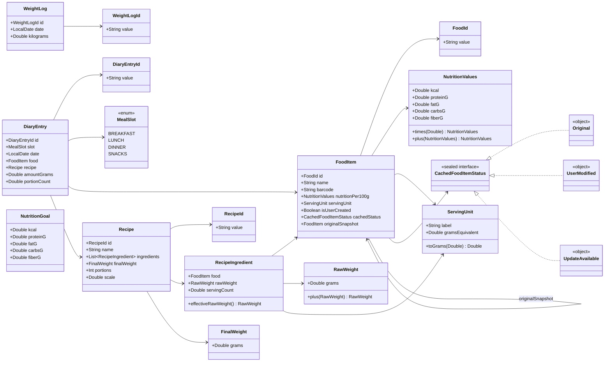
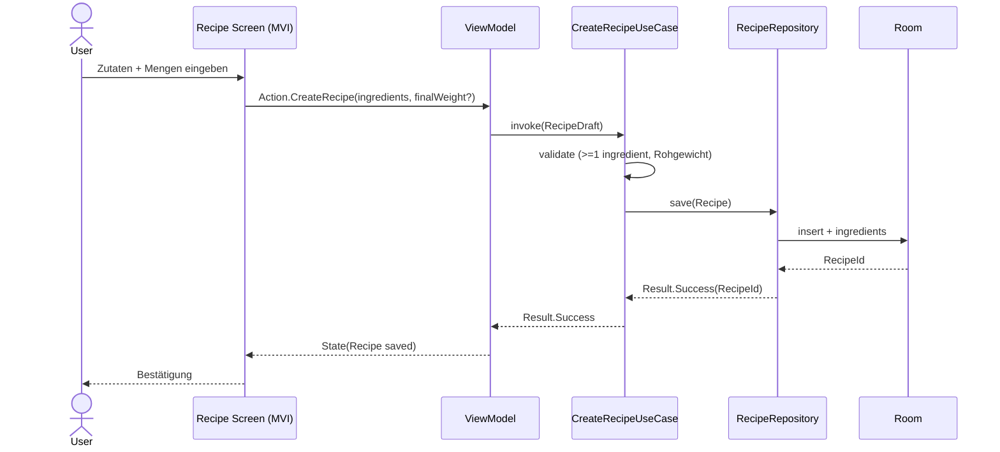
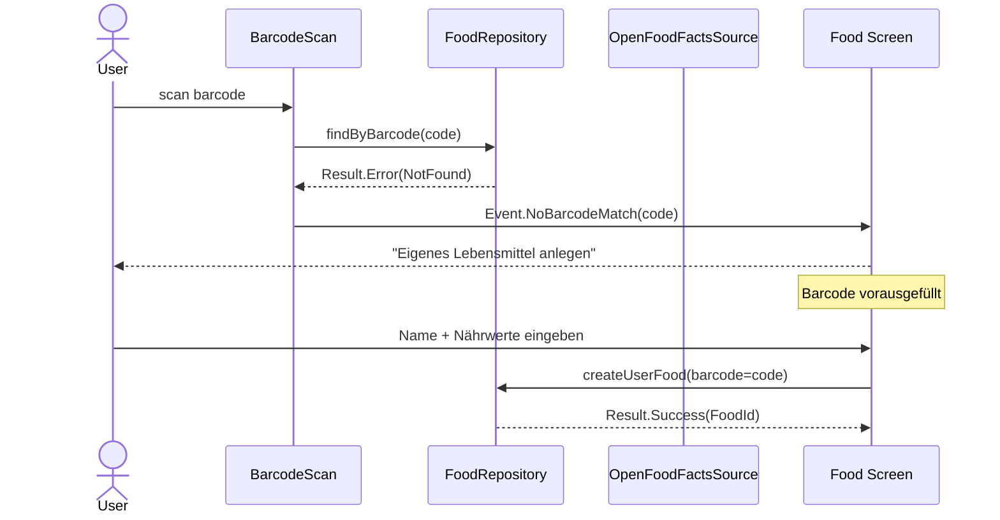

# EZ Makro — Domain Model (Phase 0.5)

## Klassendiagramm



## Sequenzdiagramm: Rezept anlegen



## Sequenzdiagramm: Barcode-Scan → Eigenes Lebensmittel



## Sequenzdiagramm: Sync mit UserModified-Konflikt (ADR-004)

```mermaid
sequenceDiagram
    participant Sync as SyncJob
    participant Repo as FoodRepository
    participant OFF as OpenFoodFactsSource
    participant DB as Room

    Sync->>Repo: syncCachedEntries()
    Repo->>OFF: fetchUpdated(code)
    OFF-->>Repo: newer OFF payload
    Repo->>DB: read local entry status
    alt status == UserModified
        Note over Repo: NIEMALS automatisch überschreiben
        Repo->>DB: set status = UpdateAvailable (Original-Snapshot bleibt)
    else status == Original
        Repo->>DB: replace with newer payload, keep status Original
    end
    Repo-->>Sync: Result.Success
    Note over Sync: UI zeigt Badge "lokal angepasst" / "Update verfügbar"
```
